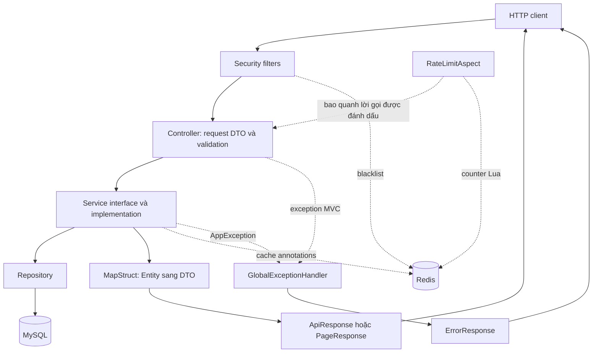
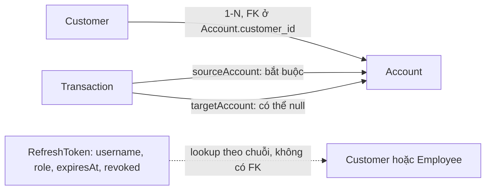
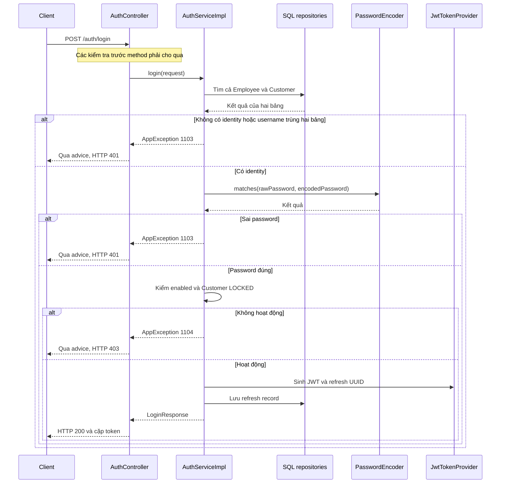
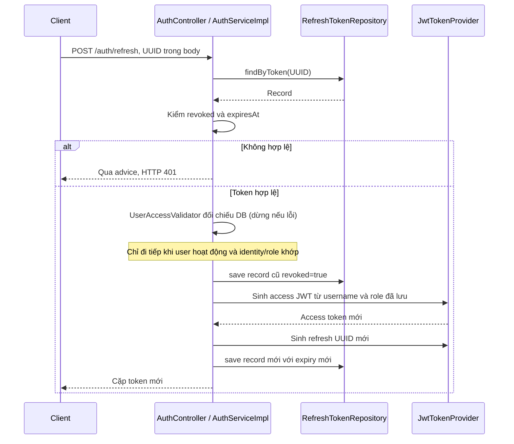
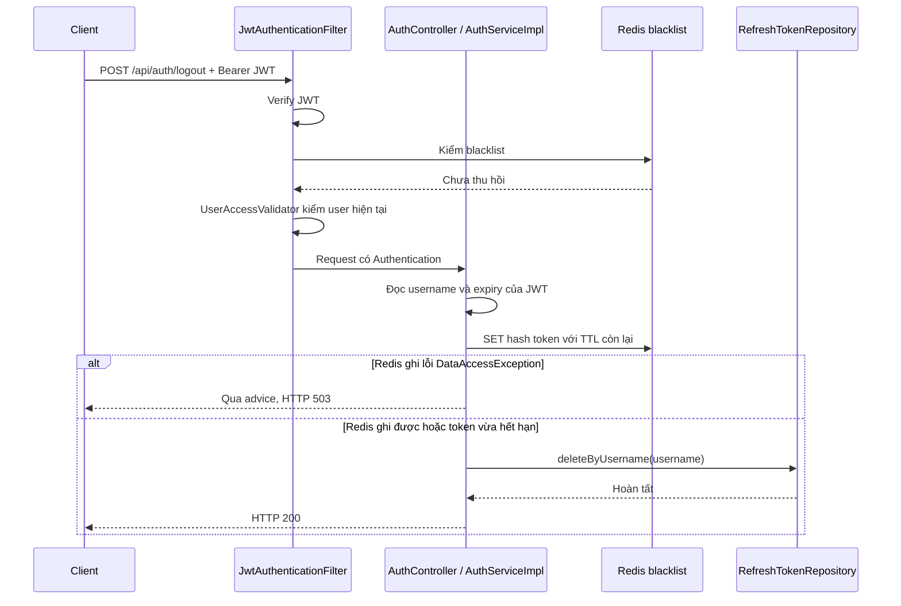
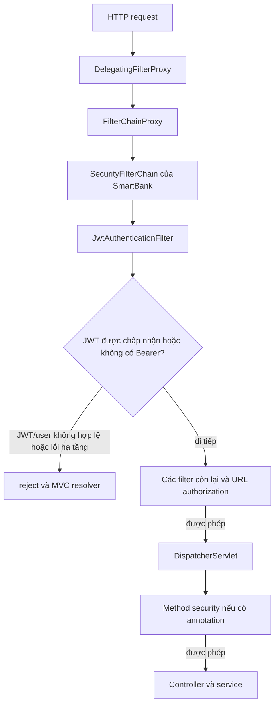

# SmartBank — Hướng dẫn đọc và review toàn bộ codebase

Khôi phục và đối chiếu working tree nhánh **learning/notes ngày 30/10/2026**, sau merge bản sửa Security `75c7a4e` từ master (merge `a9e0723`). Mục tiêu: đọc lại code theo thứ tự có chủ đích, hiểu dữ liệu đi qua đâu, nghiệp vụ được thực thi ở đâu và những annotation nào làm thay đổi hành vi chạy.

Phạm vi gồm **64 file Java production và 14 file Java test**, bao gồm class, interface, enum và annotation; mỗi file có một mục đọc chính được đánh số **01–78**. Các file cấu hình/build/deploy được hướng dẫn riêng. Lượt cập nhật tài liệu này không chạy lại ứng dụng/test; kết quả kiểm thử bản sửa trước đó được ghi riêng ở phần 10.

## Cách dùng tài liệu

1. Đi theo phần 1 → 11. Trong từng phần, đọc lý thuyết ngắn trước, sau đó mở file theo số thứ tự.
2. Mỗi file ghi lại bốn ý: đầu vào/đầu ra, ai gọi nó, side effect lên DB/Redis, trường hợp thất bại.
3. Khi đọc service, theo một method đến cùng: validation → truy vấn → kiểm tra nghiệp vụ → thay đổi dữ liệu → mapping → lỗi/response. Sau đó mới chuyển method.
4. Khi gặp annotation cache/transaction/security chưa học ở phần đó, ghi dấu và quay lại phần liên quan. Không suy hành vi chỉ từ tên annotation.
5. Cuối cùng thực hiện bài lần theo request ở phần 12; khi đó đi theo thứ tự runtime từ controller xuống service/repository.

**Vì sao thứ tự học khác thứ tự request?** Đọc entity/DTO trước giúp hiểu kiểu dữ liệu, đọc repository trước giúp hiểu service truy vấn gì. Khi đã nắm các mảnh, ghép lại theo luồng HTTP. Không cần đọc tất cả controller trước rồi đoán phần bên dưới.

| Phần | Lộ trình | Mục đọc |
|---|---|---|
| [1](#part1) | Nền tảng dự án, build và điểm khởi động | 01 + file cấu hình |
| [2](#part2) | Enum và mô hình dữ liệu | 02–11 |
| [3](#part3) | Response chung và xử lý lỗi | 12–17 |
| [4](#part4) | Luồng quản lý Customer | 18–24 |
| [5](#part5) | Luồng quản lý Account | 25–33 |
| [6](#part6) | Nạp/rút/chuyển tiền và sao kê | 34–41 |
| [7](#part7) | Redis cache và AOP rate limit | 42–44 |
| [8](#part8) | Hợp đồng và nghiệp vụ Auth | 45–54 |
| [9](#part9) | Spring Security đầy đủ: cấu hình, JWT, phân quyền và lỗi | 55–64 |
| [10](#part10) | Đọc test như bằng chứng hành vi | 65–78 |
| [11](#part11) | Build, cấu hình môi trường, Docker | File ngoài Java |
| [12](#part12) | Lần theo request và checklist kết thúc | Ôn tổng hợp |

## Những thay đổi trong lịch sử cần đọc lại

Bảng này nối các yêu cầu đã trao đổi với commit và code hiện tại. Tên commit có thể chưa phản ánh đủ nội dung; đối chiếu diff và method thực tế. Các commit `28ce55a`, `746be36` trên learning/notes còn sắp xếp code/comment học tập; không dùng tên “Pageable for Customer” để suy rằng chúng chỉ đổi Customer.

| Yêu cầu/chủ đề đã làm | Commit đối chiếu | Hành vi hiện tại và nơi đọc lại |
|---|---|---|
| Logout và token blacklist trong lịch sử dự án | `9eec977` | Hash SHA-256 + TTL trong Redis; JWT blacklist bị chặn; lỗi Redis auth trả 503. Đọc TokenBlacklistService/RedisTokenBlacklistService, JWT filter, logout và TokenBlacklistTest |
| Chặn login khi enabled=false hoặc Customer LOCKED; ném lỗi đúng | `8d0699f` | Password sai/không tồn tại trả 401/1103; đúng password nhưng inactive trả 403/1104 trước cấp token. enabled có Builder.Default; test mapper thật. Đọc entity, AuthServiceImpl và các test login |
| Bỏ cache list Customer và thêm phân trang | `13cc4ea`, `b285431` | Page<Customer> + aggregate số Account; mapper overload; page/size và lỗi 400; H2 test. Không tự loại Customer LOCKED |
| Phân trang findAllGroupedByCustomer | `6d95207`, merge `29a21a4` | Phân trang Customer trước, tải Account theo IDs sau; JOIN FETCH to-one, giữ nhóm đầy đủ và Customer chưa có Account |
| Thống nhất phân quyền endpoint, owner giao dịch, trạng thái token, username hai bảng | `75c7a4e`, merge `a9e0723` | Staff/owner đúng policy; UserAccessValidator cho access/refresh; method denial 403; 133 tests trong lượt sửa code |
| Merge giữ comment học tập | Các merge trên learning/notes | Giữ comment cũ và thêm chú thích khi hành vi đổi; comment lịch sử không có quyền ưu tiên hơn code hiện tại |

Các câu hỏi giải thích trước đây về DI, JPA, DTO, transaction, Redis và lỗi HTTP được đưa vào mục đọc tương ứng và phần 12.6; không coi mọi câu hỏi là một yêu cầu thay đổi code.

## Bản đồ để định hướng



Đọc sơ đồ theo các trách nhiệm: filters xác thực request; controller nhận/trả HTTP; service thực thi nghiệp vụ; repository truy cập dữ liệu; mapper tạo DTO. Cache/AOP có thể can thiệp vào lời gọi qua proxy. Sơ đồ không mô tả thứ tự chi tiết của mọi interceptor; exception trong filter còn có handler/resolver riêng ở phần 9.

**Các thay đổi đã đưa vào hướng dẫn:** Customer list bỏ cache và có phân trang; Account grouped list phân trang theo Customer; enabled của Customer/Employee có `@Builder.Default`; login kiểm credential rồi trạng thái; quyền xem Account đã thống nhất; giao dịch kiểm owner ở service; access/refresh token kiểm trạng thái user qua `UserAccessValidator`; lỗi method security trả 403. Các test mới đều có mục đọc riêng. [PROJECT_CONTEXT.md](PROJECT_CONTEXT.md) và [README.md](README.md) hỗ trợ tra cứu, code hiện tại là nguồn quyết định. `GEMINI.md` không có trên nhánh này; bản trên master là tài liệu cũ, không dùng để kết luận thay cho code.

**Tra cứu nhanh chương Security:** [Lộ trình và nền tảng](#security-roadmap) · [Cấu hình filter chain](#security-chain) · [Login/refresh/logout](#read53) · [JWT request](#security-jwt-flow) · [Ma trận quyền](#security-permissions) · [Ma trận lỗi](#security-errors) · [Test và checklist](#security-verification).

<a id="part1"></a>
## 1. Nền tảng dự án và điểm khởi động

**Lý thuyết ngắn trước khi đọc:** Spring Boot khởi tạo ApplicationContext, tìm các component và cấu hình bean. Constructor injection thể hiện dependency mà một class cần; bean quản lý bởi Spring có thể được bọc proxy cho transaction/cache/security. Maven quyết định dependency và quá trình compile, còn cấu hình môi trường quyết định các kết nối thực tế.

Trước khi mở class, đọc lần lượt:

| Thứ tự | File | Tập trung |
|---|---|---|
| A | [PROJECT_CONTEXT.md](PROJECT_CONTEXT.md) | Hiểu domain, kiến trúc và các điểm còn thiếu; luôn kiểm lại code. |
| B | [README.md](README.md) | Lập danh sách use case và endpoint; sơ đồ RefreshToken theo username không đồng nghĩa có foreign key. |
| C | [pom.xml](pom.xml) | Java 21, Boot 3.4.4; starters Web/JPA/Redis/Cache/AOP/Validation/Security; Lombok/MapStruct annotation processors; Surefire và plugin đóng gói. |
| D | [application.properties](src/main/resources/application.properties) | Tên property, biến môi trường, DDL, open-in-view, timeout và TTL. Không sao chép password/secret; không cần mở .env để hiểu code. |

Ở bước D, tự kiểm tra `spring.jpa.hibernate.ddl-auto` và biến môi trường của máy đang chạy; không coi default được ghi trong tài liệu cũ là cấu hình hiện tại. Đọc cấu hình đích trước khi chủ động chạy app/context test. File properties đang bị gitignore nên cấu hình giữa các máy có thể khác.

<a id="read1"></a>
### 01. [SmartBankApplication](src/main/java/com/SmartBank/SmartBankApplication.java)

Điểm bắt đầu chạy ứng dụng.

**Cần tập trung:**

- `main()` và `SpringApplication.run(...)`: nơi tạo Spring context.
- `@SpringBootApplication` và package `com.SmartBank`: liên hệ vị trí class với phạm vi component scanning.
- `@EnableCaching` ở đây và RedisConfig: bật cơ chế cache, chưa tự quyết định key hay TTL.

**Tự kiểm tra:** Vì sao controller/service tự được inject mà không có đoạn new từng class trong main?

<a id="part2"></a>
## 2. Enum và mô hình dữ liệu

**Lý thuyết ngắn trước khi đọc:** Entity mô tả dữ liệu bền vững; quan hệ Java được ánh xạ thành khóa ngoại/association. Persistence context quản lý entity đang managed; dirty checking phát hiện thay đổi để đồng bộ khi flush, còn flush không đồng nghĩa commit. Enum biểu diễn tập giá trị, không tự thực thi luật chuyển trạng thái. Với từng entity, xem ID, unique/nullability, kiểu tiền/thời gian, quan hệ, fetch/cascade và callback. LAZY giúp trì hoãn tải nhưng phải hiểu lúc nào truy cập quan hệ tạo truy vấn.

<a id="read2"></a>
### 02. [CustomerStatus](src/main/java/com/SmartBank/entity/enums/CustomerStatus.java)

Tập trạng thái hồ sơ khách hàng.

**Cần tập trung:**

- Đọc ACTIVE và LOCKED; tìm nơi set LOCKED trong CustomerServiceImpl.
- Phân biệt status với enabled: Customer muốn login/dùng token phải enabled=true và ACTIVE. Login kiểm trong AuthServiceImpl; refresh và request JWT kiểm qua UserAccessValidator. TransactionServiceImpl còn kiểm AccountStatus của tài khoản tiền, đây là trạng thái khác.

**Tự kiểm tra:** Khóa hồ sơ tác động đến login, refresh và giao dịch ở những chỗ nào?

<a id="read3"></a>
### 03. [AccountType](src/main/java/com/SmartBank/entity/enums/AccountType.java)

Loại tài khoản ngân hàng.

**Cần tập trung:**

- SAVINGS/CHECKING được dùng trong entity và hai DTO tạo tài khoản.
- Chưa có phép tính lãi khác nhau theo loại; không suy từ tên SAVINGS rằng đã triển khai lãi suất.

**Tự kiểm tra:** AccountType ảnh hưởng những nhánh if nào trong service hiện tại?

<a id="read4"></a>
### 04. [AccountStatus](src/main/java/com/SmartBank/entity/enums/AccountStatus.java)

Trạng thái tài khoản chứa tiền.

**Cần tập trung:**

- ACTIVE/FROZEN/CLOSED; lần theo kiểm tra ACTIVE trong giao dịch.
- Enum không ngăn CLOSED bị chuyển sang FROZEN; cần tìm luật chuyển trạng thái trong service.

**Tự kiểm tra:** Method freeze có kiểm tra trạng thái trước đó không?

<a id="read5"></a>
### 05. [TransactionType](src/main/java/com/SmartBank/entity/enums/TransactionType.java)

Loại bản ghi giao dịch.

**Cần tập trung:**

- DEPOSIT/WITHDRAW/TRANSFER; đối chiếu cách gán sourceAccount/targetAccount.
- Không có trạng thái SUCCESS/FAILED trong enum này hoặc field status trên Transaction.

**Tự kiểm tra:** Với deposit, sourceAccount có nghĩa là tài khoản bị trừ tiền không?

<a id="read6"></a>
### 06. [Role](src/main/java/com/SmartBank/entity/enums/Role.java)

Vai trò dùng cho identity và quyền.

**Cần tập trung:**

- CUSTOMER/EMPLOYEE/ADMIN; Customer không có field role, login gán CUSTOMER.
- CreateEmployeeRequest nhận Role nhưng service mới là nơi loại CUSTOMER.

**Tự kiểm tra:** Tại sao ba giá trị enum không có nghĩa endpoint tạo employee được phép tạo cả ba?

<a id="read7"></a>
### 07. [Customer](src/main/java/com/SmartBank/entity/Customer.java)

Hồ sơ khách hàng, credential và quan hệ tới danh sách tài khoản.

**Cần tập trung:**

- Unique email/phone/username, password, enabled, status; đối chiếu độ dài DB với DTO.
- `accountList`: mappedBy=customer, cascade ALL, LAZY; phía Account giữ khóa ngoại.
- `onCreate()` đặt createdAt và status mặc định khi persist. `enabled` có `@Builder.Default=true`, nên builder do mapper dùng giữ true khi không gán tường minh. `accountList` vẫn thiếu `@Builder.Default`, có thể null ngay sau builder.build(); kiểm generated mapper và guard null thay vì suy từ initializer.
- equals/hashCode chỉ dùng ID được Include: cân nhắc hành vi trước khi entity được cấp ID.

**Tự kiểm tra:** Khi admin tạo Customer qua mapper, enabled và accountList được gán bởi ai?

<a id="read8"></a>
### 08. [Employee](src/main/java/com/SmartBank/entity/Employee.java)

Credential cho nhân viên/admin, tách bảng với Customer.

**Cần tập trung:**

- Username unique chỉ trong Employees; role và enabled phục vụ login.
- `enabled` có `@Builder.Default=true`; builder không gán vẫn nhận true, còn enabled(false) tường minh vẫn được giữ. Bản sửa không tự cập nhật dữ liệu disabled đã tồn tại trong DB.
- @EqualsAndHashCode(onlyExplicitlyIncluded=true) nhưng ID không được Include: cần kiểm tra generated equality trước khi dùng entity làm key/set.

**Tự kiểm tra:** Hai bảng đều unique username có bảo đảm username duy nhất toàn hệ thống không?

<a id="read9"></a>
### 09. [Account](src/main/java/com/SmartBank/entity/Account.java)

Tài khoản chứa số dư, thuộc một Customer.

**Cần tập trung:**

- accountNumber unique/updatable=false khác id IDENTITY; balance là BigDecimal, precision=18/scale=2.
- Quan hệ ManyToOne LAZY và customer_id không null; đọc cả index đơn và index customer_id/status.
- `onCreate()` đặt createdAt, ACTIVE và ZERO nếu chưa có; callback chạy lúc persist, không phải ngay khi builder.build().

**Tự kiểm tra:** Object Account vừa build có chắc đã có balance/status mặc định chưa?

<a id="read10"></a>
### 10. [Transaction](src/main/java/com/SmartBank/entity/Transaction.java)

Bản ghi lịch sử nạp/rút/chuyển.

**Cần tập trung:**

- transactionCode unique; type, amount, description và createdAt.
- sourceAccount bắt buộc, targetAccount có thể null; cả hai LAZY. Đối chiếu deposit/withdraw đều lưu tài khoản thao tác ở source.
- Index source/target + created_at hỗ trợ hướng truy vấn sao kê; cần SQL/EXPLAIN mới kết luận mức hiệu quả.
- `@PrePersist onCreate()` chỉ gán thời gian khi chưa có; không có actor/audit identity đầy đủ.

**Tự kiểm tra:** Một transfer ghi mấy Transaction, và hai số dư được thay đổi ở đâu?

<a id="read11"></a>
### 11. [RefreshToken](src/main/java/com/SmartBank/entity/RefreshToken.java)

Trạng thái refresh credential lưu SQL.

**Cần tập trung:**

- Raw UUID token unique, username/role, expiresAt/revoked; username là chuỗi, không có association tới Customer/Employee.
- Index theo username/expiry giúp hướng truy vấn; index không tự dọn dữ liệu hết hạn.
- Chưa có @Version, session/token family hoặc lock trên entity.

**Tự kiểm tra:** Vì sao bảng này có dữ liệu liên quan user nhưng DB không tự bảo đảm user đó còn tồn tại?

**Hoàn thành phần 2 khi:** tự vẽ được Customer → Account → Transaction, chỉ ra hai vai trò source/target và giải thích vì sao RefreshToken đứng riêng. Đánh dấu các giả định cần kiểm tra tiếp ở mapper/service thay vì kết luận chỉ từ entity.

Sơ đồ đối chiếu cho bài tự kiểm tra (mũi tên dưới đây biểu diễn quan hệ dữ liệu, không phải thứ tự gọi method):



- Với transfer: source là Account bị trừ, target là Account được cộng. Deposit/withdraw chỉ dùng source để lưu Account thao tác, nên tên source không luôn có nghĩa bị trừ tiền.
- Account không cần collection Transaction ngược; sao kê được query bằng source OR target trong TransactionRepository.
- Từ entity chưa thể kết luận builder gán đủ default, list có lọc LOCKED, user khóa có dùng token được, hoặc refresh có kiểm user còn tồn tại. Phải kiểm CustomerMapper, service, UserAccessValidator và các test tương ứng.


<a id="part3"></a>
## 3. Response chung, validation và xử lý lỗi

**Lý thuyết ngắn trước khi đọc:** DTO là hợp đồng dữ liệu của API; Entity là mô hình lưu trữ. HTTP status nằm ở response HTTP, còn code trong JSON là quy ước của ứng dụng. Exception có thể đi từ service lên MVC advice; không phải mọi exception đều được cùng một handler xử lý. Generics cho phép tái sử dụng wrapper mà vẫn giữ kiểu dữ liệu.

<a id="read12"></a>
### 12. [ApiResponse](src/main/java/com/SmartBank/dto/response/ApiResponse.java)

Wrapper của response thành công.

**Cần tập trung:**

- `ApiResponse<T>` và các factory `success(...)`, `created(...)`: dữ liệu cụ thể được đặt trong T.
- @JsonInclude NON_NULL bỏ field null; @Builder.Default cho code/timestamp.
- Factory set code=201 trong body không tự đặt HTTP 201; controller còn dùng ResponseEntity.

**Tự kiểm tra:** Nếu chỉ trả ApiResponse.created mà không đặt status HTTP thì hai mã có chắc giống nhau?

<a id="read13"></a>
### 13. [PageResponse](src/main/java/com/SmartBank/dto/response/PageResponse.java)

Chuyển Page của Spring Data sang hợp đồng phân trang riêng.

**Cần tập trung:**

- `from(Page<T>)`: content, pageNo, pageSize, totalElements, totalPages, last.
- Phân biệt tổng bản ghi với số phần tử của trang hiện tại; page index trong code bắt đầu từ 0.

**Tự kiểm tra:** Page có 10 dòng nhưng totalElements=100 thì response biểu diễn hai con số ở đâu?

<a id="read14"></a>
### 14. [ErrorCode](src/main/java/com/SmartBank/exception/ErrorCode.java)

Danh mục mã ứng dụng, thông báo và HTTP status.

**Cần tập trung:**

- Đọc theo nhóm COMMON/AUTH/CUSTOMER/ACCOUNT/TRANSACTION; mỗi enum gói ba thuộc tính.
- Tìm caller thật của từng mã: được khai báo không đồng nghĩa đang được dùng.
- Đối chiếu lỗi không đủ tiền và validation amount; không mặc định chúng cùng trả một business code.

**Tự kiểm tra:** Mã 1402 và HTTP 400 khác nhau thế nào?

<a id="read15"></a>
### 15. [AppException](src/main/java/com/SmartBank/exception/AppException.java)

Exception nghiệp vụ mang ErrorCode.

**Cần tập trung:**

- Kế thừa RuntimeException, truyền message cho super và giữ ErrorCode.
- Service ném exception này; HTTP response do lớp xử lý lỗi quyết định.
- Liên hệ runtime exception với rollback mặc định khi gọi qua transaction proxy.

**Tự kiểm tra:** Một AppException trong service không có transaction bao trùm có hoàn tác các lần save trước không?

<a id="read16"></a>
### 16. [ErrorResponse](src/main/java/com/SmartBank/exception/ErrorResponse.java)

Schema lỗi do MVC advice trả về.

**Cần tập trung:**

- Các field code/message/path/timestamp; factory `of(ErrorCode, path)`.
- Không có field data; so schema này với ApiResponse và hai security handlers.

**Tự kiểm tra:** Client lấy HTTP status ở đâu khi JSON chỉ chứa code ứng dụng?

<a id="read17"></a>
### 17. [GlobalExceptionHandler](src/main/java/com/SmartBank/exception/GlobalExceptionHandler.java)

Chuyển exception MVC thành response.

**Cần tập trung:**

- Đọc `handleAppException` → `handleValidation` → `handleTypeMismatch` → `handleAccessDenied` → `handleGeneral`; đối chiếu HTTP status và body từng nhánh.
- Validation ghép message của field errors; catch-all trả 500 với thông báo chung.
- `handleAccessDenied` bắt AccessDeniedException từ method security và trả 403/FORBIDDEN (1003), đã có EndpointAuthorizationTest kiểm qua HTTP. Sai kiểu page/size trả 400/INVALID_REQUEST (1001). Lỗi unique constraint vẫn chưa có mapping chuyên biệt.

**Tự kiểm tra:** Một lỗi trùng DB phát sinh sau existsBy có tự biến thành EMAIL_ALREADY_EXISTS không?

<a id="part4"></a>
## 4. Review luồng Customer từ dữ liệu tới HTTP

**Lý thuyết ngắn trước khi đọc:** Một vertical slice là một chức năng đi qua DTO, mapper, repository, service và controller. Bean Validation kiểm hình dạng dữ liệu; service kiểm quy tắc nghiệp vụ; unique constraint bảo vệ dữ liệu dưới concurrency. @Transactional readOnly là gợi ý cho giao dịch đọc, không phải authorization hay lời bảo đảm tuyệt đối cấm mọi write.

<a id="read18"></a>
### 18. [CustomerRequest](src/main/java/com/SmartBank/dto/request/CustomerRequest.java)

Đầu vào tạo/cập nhật hồ sơ.

**Cần tập trung:**

- Tên tối đa 100; @Email; phone giới hạn độ dài 10–11; dateOfBirth @Past.
- Username/password bắt buộc dù DTO cũng dùng cho update; update service hiện không thay hai field đó.
- @Size cho phone chỉ kiểm độ dài, chưa bảo đảm chỉ chứa chữ số.

**Tự kiểm tra:** Client PUT hồ sơ phải gửi những field nào, và field nào thực tế được cập nhật?

<a id="read19"></a>
### 19. [CustomerResponse](src/main/java/com/SmartBank/dto/response/CustomerResponse.java)

Dữ liệu hồ sơ được trả cho client.

**Cần tập trung:**

- Không có password/username/enabled; có PII như email/phone/address/dateOfBirth.
- status được trả dạng String, totalAccounts phải được tính từ quan hệ.
- So field response với request để thấy API không chỉ copy nguyên entity.

**Tự kiểm tra:** Tính totalAccounts có thể khiến Hibernate tải thêm dữ liệu không?

<a id="read20"></a>
### 20. [CustomerMapper](src/main/java/com/SmartBank/mapper/CustomerMapper.java)

Mapping hồ sơ bằng MapStruct.

**Cần tập trung:**

- `toEntity`: ignore id/status/createdAt/password/enabled/accountList; tìm chỗ gán bù ở service/callback.
- `toResponse(Customer)`: expression lấy accountList.size(), có guard null. Overload `toResponse(Customer, int totalAccounts)` dùng số đếm aggregate cho list phân trang, tránh tải accountList để đếm.
- componentModel=spring tạo implementation dạng bean lúc compile; có thể xem generated source sau compile nhưng không sửa trực tiếp file sinh.

**Tự kiểm tra:** Vì sao mapper ignore password và service phải encode trước save?

<a id="read21"></a>
### 21. [CustomerRepository](src/main/java/com/SmartBank/repository/CustomerRepository.java)

Truy vấn hồ sơ và danh sách tài khoản.

**Cần tập trung:**

- Các existsBy chỉ kiểm bảng Customer; findByUsername trả Optional.
- `findAll(Pageable)` kế thừa JpaRepository dùng cho list Customer và list nhóm Account.
- `countAccountsByCustomerIds`: GROUP BY + COUNT trả interface projection CustomerAccountCount; chỉ đếm Account của các Customer trong trang. Customer không có Account không có dòng aggregate, service dùng mặc định 0.
- `findAllCustomersWithAccounts`: LEFT JOIN FETCH + DISTINCT vẫn được khai báo nhưng hai luồng list hiện không gọi nữa; không thêm Pageable vào collection fetch rồi mặc định DB sẽ phân trang đúng.

**Tự kiểm tra:** Nếu thay JOIN FETCH bằng JOIN thường, truy cập accountList sau đó có gì cần đo lại?

<a id="read22"></a>
### 22. [CustomerService](src/main/java/com/SmartBank/service/CustomerService.java)

Hợp đồng nghiệp vụ quản lý khách hàng.

**Cần tập trung:**

- Đọc chữ ký create/getAll/getById/deleteById/update/getAccountsByID và kiểu DTO trả về. `getAllCustomers(int page, int size)` trả PageResponse<CustomerResponse>, không còn List.
- Phân biệt getAccountsByID nhận customerId với AccountService.getByID nhận accountId.

**Tự kiểm tra:** Controller cần biết repository nào được dùng để thực hiện hợp đồng này không?

<a id="read23"></a>
### 23. [CustomerServiceImpl](src/main/java/com/SmartBank/service/impl/CustomerServiceImpl.java)

Đọc theo thứ tự create → getById → getAllCustomers → update → deleteById → getAccountsByID.

**Cần tập trung:**

- `create`: kiểm trùng email/phone trong Customer và username ở cả Customer/Employee → map → encode password → save → response. Check trước save không phải UNIQUE xuyên hai bảng dưới concurrency.
- `getAllCustomers(page,size)`: kiểm page >= 0, size 1–100 → PageRequest sort id DESC → findAll → lấy ID trong trang → query aggregate số Account → page.map qua mapper overload. Mặc định HTTP page=0/size=10, không cache list. Trang rỗng bỏ qua query count Account; vẫn giữ metadata Page.
- `getAccountsByID`: truy cập collection trong transaction đọc và vẫn dùng cache accounts_customers; khác với list phân trang không tải accountList.
- `update`: chỉ sửa profile; kiểm tra ảnh hưởng unique constraint và các cache view liên quan khi đổi email/phone. List Customer không còn cache nhưng cache chi tiết/customer-account vẫn cần invalidation phù hợp.
- `deleteById`: set LOCKED và save, không xóa hàng. Các truy vấn findById/list không tự lọc LOCKED.
- Đánh dấu Cacheable/CachePut/CacheEvict để quay lại phần 7; xóa cache theo ID chưa đồng nghĩa làm mới mọi view.

**Tự kiểm tra:** Khách hàng bị soft delete có còn xuất hiện trong getAllCustomers không, và code nào quyết định điều đó?

<a id="read24"></a>
### 24. [CustomerController](src/main/java/com/SmartBank/controller/v1/CustomerController.java)

Ghép nghiệp vụ Customer với HTTP.

**Cần tập trung:**

- Base route `/api/v1/customers`; đọc create/getCustomerByID/getAllCustomers/update/deleteById/getAccountsByID. GET list nhận page/size, trả ApiResponse<PageResponse<CustomerResponse>>: dữ liệu nằm trong data.content; sai page/size trả 400, trang vượt phạm vi trả 200 với content rỗng.
- Theo dấu @Valid, request/path binding, HTTP CREATED/OK và ApiResponse.
- Quyền ADMIN nằm ở SecurityConfig; method không tự có authorization chỉ vì controller quản lý customer.

**Tự kiểm tra:** Lần theo POST tạo customer bị trùng email tới ErrorResponse, chỉ ra nơi phát sinh lỗi.

**Bài review nhỏ:** viết lại luồng POST `/api/v1/customers` bằng tên 6 thành phần: Request → Controller → Service → Mapper/Repository → Entity/DB → Response. Với mỗi bước, chỉ ra dữ liệu nào do client gửi và dữ liệu nào server tự gán.

<a id="part5"></a>
## 5. Review luồng Account và quan hệ với Customer

**Lý thuyết ngắn trước khi đọc:** Một tài khoản có định danh nội bộ id và số tài khoản nghiệp vụ accountNumber. Service cần phân biệt người tạo hộ với khách hàng tự tạo cho mình. Mapping entity có quan hệ LAZY có thể phát sinh query; cache DTO giúp tránh trả persistence proxy nhưng làm phát sinh bài toán dữ liệu cũ.

<a id="read25"></a>
### 25. [AccountCreateRequest](src/main/java/com/SmartBank/dto/request/AccountCreateRequest.java)

Đầu vào tạo tài khoản cho customerId chỉ định.

**Cần tập trung:**

- customerId và type đều @NotNull; không nhận balance/accountNumber/status.
- customerId tồn tại phải được kiểm tra ở service, không được @NotNull chứng minh.

**Tự kiểm tra:** Người gọi có thể tự yêu cầu số dư ban đầu qua DTO này không?

<a id="read26"></a>
### 26. [CustomerAccountCreateRequest](src/main/java/com/SmartBank/dto/request/CustomerAccountCreateRequest.java)

Đầu vào tạo tài khoản cho chính người đăng nhập.

**Cần tập trung:**

- Chỉ có type; không có customerId.
- Đối chiếu AccountController.createMyAccount lấy username từ Authentication.

**Tự kiểm tra:** Vì sao cần DTO riêng cho /my thay vì dùng AccountCreateRequest?

<a id="read27"></a>
### 27. [AccountResponse](src/main/java/com/SmartBank/dto/response/AccountResponse.java)

View tài khoản và một phần thông tin chủ sở hữu.

**Cần tập trung:**

- id/accountNumber/type/balance/status/createdAt, customerId/customerName.
- BigDecimal được giữ tới response; tên/type/status không phải toàn bộ entity Customer.

**Tự kiểm tra:** Mapper phải truy cập association nào để điền customerName?

<a id="read28"></a>
### 28. [CustomerAccountResponse](src/main/java/com/SmartBank/dto/response/CustomerAccountResponse.java)

View gom tài khoản theo khách hàng.

**Cần tập trung:**

- customerId/customerName/customerEmail cùng List<AccountResponse>.
- Khác CustomerResponse.totalAccounts: một bên trả danh sách, một bên chỉ trả số lượng. Mỗi phần tử PageResponse<CustomerAccountResponse> là một Customer; size giới hạn số Customer, không giới hạn số Account trong một nhóm.

**Tự kiểm tra:** Có rủi ro response lớn ở GET danh sách nhóm theo customer không?

<a id="read29"></a>
### 29. [AccountMapper](src/main/java/com/SmartBank/mapper/AccountMapper.java)

Mapping Account và Customer thành DTO/entity.

**Cần tập trung:**

- `toResponse`: customer.id/fullName → customerId/customerName.
- `toEntity`: nhận cả request và Customer; ignore accountNumber/balance/status/createdAt.
- Tách trách nhiệm: service sinh số tài khoản; callback gán mặc định ở persist; mapper gán quan hệ.

**Tự kiểm tra:** Nếu bỏ truy vấn Customer ở service và chỉ gán customerId vào DTO, mapper hiện có đủ dữ liệu không?

<a id="read30"></a>
### 30. [AccountRepository](src/main/java/com/SmartBank/repository/AccountRepository.java)

Tra cứu và khóa hàng tài khoản.

**Cần tập trung:**

- findByAccountNumber trả Account có thể null; findById kế thừa trả Optional.
- existsByAccountNumber phục vụ sinh số; không thay thế unique constraint khi hai request cùng tạo.
- `findByAccountNumberWithLock`: @Lock PESSIMISTIC_WRITE + JPQL có parameter; sẽ đọc lại ở phần chuyển tiền.
- `findAllByCustomerIdsWithCustomer`: lấy Account của các customerId trong trang, JOIN FETCH a.customer (to-one), ORDER BY a.id ASC. Không phân trang query Account này và không fetch collection accountList.

**Tự kiểm tra:** Tại sao cùng tìm theo accountNumber nhưng cần cả method có lock và không lock?

<a id="read31"></a>
### 31. [AccountService](src/main/java/com/SmartBank/service/AccountService.java)

Hợp đồng đọc/tạo/đổi trạng thái tài khoản.

**Cần tập trung:**

- Phân biệt create(request customerId) với createAccountForCustomer(username,...).
- getByID khác getAccountsByUsername; findAllGroupedByCustomer(int page,int size) trả PageResponse<CustomerAccountResponse>. Đơn vị phân trang là Customer.

**Tự kiểm tra:** Những method nào là read, write, và method nào cần danh tính người gọi?

<a id="read32"></a>
### 32. [AccountServiceImpl](src/main/java/com/SmartBank/service/impl/AccountServiceImpl.java)

Đọc create → generateAccountNumber → createAccountForCustomer → getByID/getAccountsByUsername → findAllGroupedByCustomer → freeze/close.

**Cần tập trung:**

- Class readOnly transaction, các write method override @Transactional; controller gọi bean service qua interface.
- `generateAccountNumber`: random số 10 chữ số rồi exists check; concurrency vẫn cần DB unique và chính sách xử lý collision.
- Hai đường tạo có cách gán mặc định khác nhau: mapper + callback và new Account + setters.
- `findAllGroupedByCustomer`: kiểm page/size như Customer list; lấy Page<Customer> sort id DESC trước, rồi query toàn bộ Account thuộc các ID trong trang. Map AccountResponse, groupingBy customerId, sau đó Page.map thành CustomerAccountResponse.
- Trang rỗng bỏ qua query Account; Customer không có Account nhận accounts=[]; Customer LOCKED vẫn được liệt kê. Account trong nhóm sort id ASC. Không cache list; collection accountList không bị tải để dựng nhóm.
- JOIN FETCH ở query thứ hai là to-one nên tránh mapper gây N+1 mà không phân trang collection fetch. Một Customer có rất nhiều Account vẫn làm response lớn, dù size <= 100.
- `freeze/close`: set status trực tiếp, chưa có bảng luật chuyển trạng thái hoặc kiểm số dư khi đóng; cache đọc chưa được evict ở các method này.

**Tự kiểm tra:** Sau khi GET một account đã vào cache rồi PATCH freeze, GET tiếp có thể thấy trạng thái nào?

<a id="read33"></a>
### 33. [AccountController](src/main/java/com/SmartBank/controller/v1/AccountController.java)

HTTP cho tài khoản của staff và self-service.

**Cần tập trung:**

- POST/GET gốc, GET /{id}, PATCH /{id}/freeze và /close, GET/POST /my.
- /my lấy username từ Authentication và chỉ cho CUSTOMER. getById có @PreAuthorize ADMIN/EMPLOYEE hoặc CUSTOMER owner; truyền Authentication vào helper.
- Đối chiếu URL rule GET /{id} cho cả ba role, method thu hẹp CUSTOMER theo owner. Mâu thuẫn cũ đã được sửa; comment cũ được giữ cùng chú thích cập nhật trên learning/notes.
- GET gốc nhận page=0/size=10, trả ApiResponse<PageResponse<CustomerAccountResponse>>, giới hạn size 100 và metadata theo Customer.

**Tự kiểm tra:** Quyền hiệu lực của endpoint được quyết định bởi một annotation hay mọi lớp kiểm tra áp dụng?


<a id="part6"></a>
## 6. Nạp/rút/chuyển tiền và sao kê

**Lý thuyết ngắn trước khi đọc:** BigDecimal tránh sai số nhị phân của float/double nhưng vẫn cần policy scale/rounding phù hợp. Transaction gom thay đổi DB để commit/rollback cùng nhau; lock kiểm soát truy cập đồng thời vào hàng dữ liệu. Lock ordering giảm khả năng các transaction chờ nhau theo vòng. Những cơ chế này bảo vệ tính nhất quán, không tự chứng minh quyền sở hữu hay ngăn client gửi lặp giao dịch.

<a id="read34"></a>
### 34. [DepositWithDrawRequest](src/main/java/com/SmartBank/dto/request/DepositWithDrawRequest.java)

Đầu vào dùng chung cho nạp và rút.

**Cần tập trung:**

- accountNumber @NotBlank; amount @NotNull, tối thiểu 1.000 và tối đa 500.000.000; description tối đa 255.
- DTO chỉ kiểm đầu vào; trạng thái account và đủ tiền phải kiểm tra sau khi lấy dữ liệu.

**Tự kiểm tra:** Amount hợp lệ về khoảng giá trị có bảo đảm rút tiền thành công không?

<a id="read35"></a>
### 35. [TransferRequest](src/main/java/com/SmartBank/dto/request/TransferRequest.java)

Đầu vào chuyển tiền giữa hai account.

**Cần tập trung:**

- sourceAccountNumber/targetAccountNumber bắt buộc; amount tối thiểu 1.000.
- Hiện không có DecimalMax như nạp/rút; cùng tài khoản nguồn/đích được chặn trong service.
- Chưa có requestId/idempotencyKey để phân biệt retry với giao dịch mới.

**Tự kiểm tra:** Khi request chuyển tiền bị timeout, gửi lại payload giống hệt có thể tạo thêm giao dịch không?

<a id="read36"></a>
### 36. [TransactionResponse](src/main/java/com/SmartBank/dto/response/TransactionResponse.java)

View một giao dịch.

**Cần tập trung:**

- transactionCode/type/amount/description/createdAt, sourceAccountNumber/targetAccountNumber.
- targetAccountNumber null cho deposit/withdraw; không có trạng thái thành công/thất bại riêng.

**Tự kiểm tra:** Có thể dùng DTO này để biết chính xác nhân viên nào thực hiện giao dịch không?

<a id="read37"></a>
### 37. [TransactionMapper](src/main/java/com/SmartBank/mapper/TransactionMapper.java)

Flatten quan hệ Account sang số tài khoản.

**Cần tập trung:**

- Map sourceAccount.accountNumber và targetAccount.accountNumber; kiểm generated null handling cho target null.
- Mapping Page<Transaction> gọi mapper cho từng phần tử; quan hệ LAZY có thể ảnh hưởng số query.

**Tự kiểm tra:** Sao kê nhiều dòng có thể phát sinh truy vấn phụ ở bước mapping nào?

<a id="read38"></a>
### 38. [TransactionRepository](src/main/java/com/SmartBank/repository/TransactionRepository.java)

Truy vấn lịch sử theo tài khoản.

**Cần tập trung:**

- Đọc tên method findBySourceAccount_AccountNumberOrTargetAccount_AccountNumber theo từng đoạn property.
- Hai tham số cùng nhận accountNumber khi truy vấn sao kê; OR lấy giao dịch vào hoặc ra.
- Pageable quyết định page/size/sort, Page còn có metadata tổng; query không tự kiểm caller có quyền xem account.

**Tự kiểm tra:** Vì sao chỉ lọc sourceAccount sẽ thiếu giao dịch chuyển tiền vào?

<a id="read39"></a>
### 39. [TransactionService](src/main/java/com/SmartBank/service/TransactionService.java)

Hợp đồng giao dịch và sao kê.

**Cần tập trung:**

- Ba write method nhận DTO; sao kê trả PageResponse<TransactionResponse>.
- Có @Valid trên tham số, nhưng không mặc định gọi service trực tiếp trong unit test sẽ kích hoạt method validation; HTTP controller hiện có @Valid.

**Tự kiểm tra:** Một test gọi service bằng object amount âm có đi qua cùng validation như HTTP không?

<a id="read40"></a>
### 40. [TransactionServiceImpl](src/main/java/com/SmartBank/service/impl/TransactionServiceImpl.java)

Đây là class cần đọc kỹ nhất về tính đúng đắn dữ liệu. Đọc deposit → withdraw → transfer → getAccountStatement → generateTransactionCode.

**Cần tập trung:**

- `deposit`: lookup có lock → tồn tại/ACTIVE → cộng balance → save account → tạo Transaction. Chưa có xác nhận nguồn tiền từ bên thanh toán.
- `withdraw`: lookup có lock → tồn tại/ACTIVE → kiểm số dư → trừ balance → lưu lịch sử. Theo dấu mọi AppException trước side effect.
- `transfer`: chặn source=target → chọn thứ tự khóa bằng String.compareTo(accountNumber) → khóa hai hàng → ánh xạ lại source/target → kiểm tồn tại/ACTIVE/đủ tiền → cập nhật hai số dư → lưu một Transaction.
- Vẽ ranh giới @Transactional: lỗi lưu lịch sử phải được xem cùng thay đổi số dư trong transaction DB. Unit test mock repo không chứng minh rollback thực.
- `getAccountStatement`: exists check → PageRequest với createdAt DESC → repository OR → page.map(mapper) → PageResponse. Chưa có giới hạn size tối đa hay sort phụ khi timestamp trùng.
- `generateTransactionCode`: TXN + milliseconds; unique DB có thể gặp collision. @CacheEvict allEntries xóa ba vùng cache; không biến SQL và Redis thành một transaction chung.
- Trước body mỗi write method, @PreAuthorize cho ADMIN/EMPLOYEE hoặc CUSTOMER owner. deposit/withdraw dùng #request.accountNumber; transfer dùng #request.sourceAccountNumber. Authentication lấy từ SecurityContext qua expression, không cần thêm username do client gửi.
- Quyền được kiểm ở service proxy nên gọi service bằng new/Mockito không kiểm annotation; EndpointAuthorizationTest kiểm bằng bean Spring thật. Không có idempotency hoặc kiểm thử cạnh tranh MySQL thực tế.

**Tự kiểm tra:** Nếu hai request đồng thời rút 800.000 từ số dư 1.000.000, lock và transaction phải phối hợp thế nào để chỉ một request thành công?

<a id="read41"></a>
### 41. [TransactionController](src/main/java/com/SmartBank/controller/v1/TransactionController.java)

Nối HTTP với giao dịch và sao kê.

**Cần tập trung:**

- POST deposit/withdraw/transfer dùng @Valid, @RateLimit(10,60), trả HTTP 201.
- GET /account/{accountNumber} mặc định page=0/size=10; @PreAuthorize staff hoặc owner.
- Theo dấu thứ tự các lớp: request phải qua security, MVC binding/validation và interceptor áp dụng trước khi nghiệp vụ chạy; không suy thứ tự mọi aspect nếu chưa kiểm tra cấu hình.

**Tự kiểm tra:** Khi sai amount, thiếu quyền và vượt rate limit cùng lúc, có thể dự đoán chỉ từ body lỗi nghiệp vụ không?

**Bài lần theo chuyển tiền bằng giấy:**

| Điểm dừng | Cần ghi ra |
|---|---|
| Sau đọc request | Source, target, amount; dữ liệu nào do client quyết định |
| Sau chọn thứ tự lock | firstLockNum, secondLockNum; đừng nhầm firstLock với source |
| Sau lookup | Những điều kiện nào trả lỗi trước khi sửa balance |
| Sau thay đổi số dư | source giảm, target tăng cùng một amount; tổng hai số dư có giữ nguyên không |
| Sau lưu Transaction | Source/target/type/code của bản ghi |
| Nếu repository ném lỗi | Ranh giới transaction, rollback cần kiểm thử gì |
| Khi client retry | Code hiện có nhận ra request trùng không |

Thử thêm chiều chuyển ngược lại để thấy cùng một cặp account vẫn được khóa theo cùng thứ tự từ điển.

<a id="part7"></a>
## 7. Redis cache và AOP rate limit

**Lý thuyết ngắn trước khi đọc:** Spring Cache gắn hành vi cache vào lời gọi qua proxy: Cacheable có thể trả dữ liệu mà không chạy method body, CachePut chạy method rồi cập nhật cache, CacheEvict loại dữ liệu. TTL giới hạn thời gian sống nhưng không thay thế invalidation đúng. AOP tách logic dùng chung khỏi nghiệp vụ; gọi nội bộ cùng object có thể không đi qua proxy. Redis template dùng cho thao tác trực tiếp khác với cache manager phục vụ annotation.

<a id="read42"></a>
### 42. [RedisConfig](src/main/java/com/SmartBank/config/RedisConfig.java)

Nơi nối connection factory với ba cách dùng Redis.

**Cần tập trung:**

- Đọc cacheManager → redisTemplate → rateLimitRedisTemplate; phân biệt kiểu bean và serializer.
- Default cache TTL 10 phút; accounts 5, customers 30, accounts_customers 10; không cache null.
- RedisTemplate<String,Object> dùng value JSON; StringRedisTemplate phục vụ rate limiter và blacklist dù tên bean chỉ nhắc rate limit.
- @EnableCaching bật xử lý annotation; cấu hình property spring.cache.redis.* không nên được mặc định là nơi quyết định TTL khi đã có custom cache manager.

**Tự kiểm tra:** Thay TTL của accounts có làm thay TTL blacklist token không?

Sau RedisConfig, quay lại các method đã đọc và lập bảng cache. `getAllCustomers(page,size)` và `findAllGroupedByCustomer(page,size)` đều không cache; TTL cấu hình cho một vùng không tự làm mọi method dùng vùng đó:

| Vùng cache | Đường đọc/ghi hiện có | Cần kiểm tra |
|---|---|---|
| accounts | AccountServiceImpl.getByID, getAccountsByUsername | Hai kiểu kết quả chung một vùng; quy ước key cần rõ ràng |
| customers | CustomerServiceImpl.getById; update CachePut; delete CacheEvict | getAllCustomers đã bỏ cache; chỉ cache chi tiết theo ID |
| accounts_customers | CustomerServiceImpl.getAccountsByID | Tạo account mới có làm mới danh sách đang cache không |
| Cả ba vùng | TransactionServiceImpl deposit/withdraw/transfer evict allEntries | Độ rộng invalidation; thời điểm eviction so với commit; Redis lỗi thì sao |

**Hiện trạng cần nhận ra:** create/freeze/close của AccountServiceImpl chưa có eviction tương ứng. Không kết luận cache luôn phản ánh DB chỉ vì TTL đã được cấu hình.

#### 42.1. Bean nào được inject cho Security?

Hai caller trực tiếp của bean `rateLimitRedisTemplate` là [RateLimitAspect](#read44) và [RedisTokenBlacklistService](#read59). Cả hai constructor nhận `StringRedisTemplate` kèm Qualifier cùng tên.

Trong `RedisConfig`, chỉ có một bean được khai báo với kiểu trả về `StringRedisTemplate`: `rateLimitRedisTemplate`. Bean `redisTemplate` trả `RedisTemplate<String,Object>`, không phải một StringRedisTemplate thứ hai; `cacheManager` cũng không phải template. Vì vậy không thể nhìn ba method @Bean rồi kết luận có ba ứng viên StringRedisTemplate.

Qualifier nêu rõ bean muốn chọn, hữu ích khi có thêm bean cùng kiểu. Việc nó có bắt buộc trong context cụ thể hay không phụ thuộc các bean thực sự được tạo, kể cả điều kiện auto-configuration của Boot. Không khẳng định luôn tồn tại thêm bean `stringRedisTemplate` mặc định chỉ từ tên class thư viện. Khi debug ambiguity, xem danh sách bean theo kiểu hoặc condition report thực tế.

TTL cache không điều khiển TTL blacklist/rate limit: cache dùng cấu hình vùng; blacklist lấy expiry JWT; counter lấy duration trên annotation.

<a id="read43"></a>
### 43. [RateLimit](src/main/java/com/SmartBank/security/ratelimit/RateLimit.java)

Custom annotation đánh dấu method cần giới hạn lượt gọi.

**Cần tập trung:**

- @Target METHOD và @Retention RUNTIME; default requests=5, duration=60.
- Annotation chỉ chứa metadata; RateLimitAspect mới thực thi giới hạn.
- Tìm usages ở AuthController và TransactionController.

**Tự kiểm tra:** Chỉ thêm @RateLimit mà không có aspect thì counter có được tăng không?

<a id="read44"></a>
### 44. [RateLimitAspect](src/main/java/com/SmartBank/security/ratelimit/RateLimitAspect.java)

Đọc metadata annotation, tạo Redis counter và chặn vượt quota.

**Cần tập trung:**

- @Before("@annotation(rateLimit)") lấy annotation instance; RequestContextHolder cung cấp request hiện tại.
- generateKey dùng remoteAddr + URI; sau reverse proxy cần kiểm tra IP thực tế được nhận.
- Lua INCR rồi EXPIRE khi count=1: cửa sổ tính từ lần tạo key, không phải sliding window; thao tác script diễn ra phía Redis.
- count vượt requests → TOO_MANY_REQUESTS/429; count=null không vào nhánh reject; lỗi Redis thường được rethrow tới advice.
- Log key/count khác security audit; aspect đếm lượt gọi tới method, không chỉ đếm password sai.

**Tự kiểm tra:** Tại sao tách INCR và EXPIRE thành hai lần gọi có thể để lại key không có TTL?


#### 44.1. Rate limit trong bức tranh Security

**Lý thuyết ngắn:** giới hạn tần suất làm giảm lạm dụng tài nguyên, nhưng không chứng minh danh tính, không thay thế quyền sở hữu và không bảo đảm giao dịch chỉ được xử lý một lần.

| Method/API | Quota được khai báo | Phạm vi counter |
|---|---|---|
| POST /auth/register | 3 lần / 60 giây | IP + URI |
| POST /auth/login | 5 lần / 60 giây | IP + URI |
| POST /api/v1/transactions/deposit | 10 lần / 60 giây | IP + URI |
| POST /api/v1/transactions/withdraw | 10 lần / 60 giây | IP + URI |
| POST /api/v1/transactions/transfer | 10 lần / 60 giây | IP + URI |
| Refresh, logout, API đọc | Chưa gắn RateLimit | Không hưởng quota chỉ vì dùng chung controller |

Đọc Lua theo ba thao tác: tăng INCR → chỉ EXPIRE khi count bằng 1 → trả count. Script chạy nguyên tử ở Redis, tránh khoảng đua giữa hai lệnh gửi rời. Cửa sổ bắt đầu khi counter được tạo và không trượt theo từng request; đây chưa phải sliding window hay token bucket.

Đọc Java tiếp: `count > requests` mới chặn nên N lần đầu trong cửa sổ được đi tiếp; lượt bị chặn vẫn đã tăng counter. `count == null` không bị reject. Lỗi Redis được log rồi rethrow; chưa có chính sách 503 giống blacklist và chưa trả Retry-After.

Aspect chạy trước method controller được gắn annotation; những request bị filter/URL security hoặc bước binding/validation chặn trước khi gọi method có thể không được đếm. Nó cũng đếm login thành công, không chỉ password sai. IP chung qua NAT có thể dùng chung quota; sau proxy phải kiểm `getRemoteAddr()` phản ánh ai. Chưa có bộ đếm sai password theo username hay khóa tạm tài khoản.

**Bài review:** đặt ba request login đúng và ba request login sai từ cùng IP, cùng URI trong một cửa sổ; giải thích tại sao đây là một counter chung. Sau đó đổi URI sang refresh để thấy giới hạn hiện tại không áp dụng cho endpoint đó.

<a id="part8"></a>
## 8. Hợp đồng và nghiệp vụ Auth

**Lý thuyết ngắn trước khi đọc:** Authentication (xác thực) xác minh danh tính; authorization (phân quyền) quyết định quyền trên tài nguyên. Password dùng khi login; access token dùng cho request tiếp theo; refresh token dùng để cấp cặp token mới. Phần 8 và 9 trình bày đầy đủ từ khái niệm đến luồng code, không yêu cầu đã đọc tài liệu Security khác.

<a id="security-roadmap"></a>
### Lộ trình đọc riêng cho toàn bộ Security

Nếu ôn Security như một chương độc lập, đi theo bảng này. Số mục 01–78 của hướng dẫn tổng thể vẫn được giữ để tiện tra cứu.

| Lượt | File/mục đọc theo thứ tự | Mục tiêu |
|---|---|---|
| 1 | [Role](#read6) → [Customer](#read7) → [Employee](#read8) → [RefreshToken](#read11) | Hiểu nguồn danh tính, trạng thái, role và dữ liệu phiên |
| 2 | [SecurityConfig](#read55) → [CustomUserDetailsService](#read56) → [EmployeeRepository](#read50) + [CustomerRepository](#read21) | Phân biệt cấu hình provider với đường login thực tế |
| 3 | [RegisterRequest](#read45) → [LoginRequest](#read46) → [CreateEmployeeRequest](#read47) → [LoginResponse](#read49) → [AuthService](#read52) → [AuthServiceImpl](#read53) → [AuthController](#read54) | Đăng ký, tạo staff, BCrypt, login và lỗi inactive |
| 4 | [JwtTokenProvider](#read57) → [TokenBlacklistService](#read58) → [RedisConfig](#read42) → [RedisTokenBlacklistService](#read59) → [UserAccessValidator](#read60) → [JwtAuthenticationFilter](#read61) | Một JWT biến thành Authentication như thế nào |
| 5 | [AccountSecurity](#read62) → [AccountController](#read33) → [TransactionController](#read41) → [TransactionServiceImpl](#read40) | RBAC kết hợp quyền sở hữu; quyền đọc ở controller và quyền ghi tiền ở service |
| 6 | [CustomAuthenticationEntryPoint](#read63) → [CustomAccessDeniedHandler](#read64) → [ErrorCode](#read14) → [AppException](#read15) → [ErrorResponse](#read16) → [GlobalExceptionHandler](#read17) | Lần đúng đường đi 401/403/503 thay vì đoán từ tên exception |
| 7 | [RefreshRequest](#read48) → [RefreshTokenRepository](#read51) → đọc lại refresh/logout của [AuthServiceImpl](#read53) | Rotation, phạm vi logout, concurrency và lỗi giữa hai hệ lưu trữ |
| 8 | [RateLimit](#read43) → [RateLimitAspect](#read44) → [AuthServiceTest](#read68) → [JwtTokenProviderTest](#read69) → [TokenBlacklistTest](#read70) | Chống gọi quá nhiều, ranh giới test và các case còn thiếu |
| 9 | [AuthLoginResponseTest](#read71) → [AccountSecurityTest](#read76) → [EndpointAuthorizationTest](#read77) | Đối chiếu 401/403, owner, trạng thái user và filter/method security thật |

Các link nội bộ dùng số thứ tự thực tế trong tài liệu; không phải thứ tự thực thi runtime.

#### Các khái niệm cần biết trước khi mở class

| Khái niệm | Nghĩa ngắn gọn | Liên hệ SmartBank |
|---|---|---|
| Principal | Chủ thể đã được nhận diện | JWT filter dùng String username |
| Credentials | Bằng chứng xác thực | Password khi login; bearer token ở request API |
| Authentication | Object chứa principal, credentials, authorities và trạng thái xác thực | Filter tạo sau khi JWT, blacklist và UserAccessValidator đều cho qua |
| GrantedAuthority | Một quyền Spring Security dùng để quyết định truy cập | `ROLE_CUSTOMER`, `ROLE_EMPLOYEE`, `ROLE_ADMIN` |
| SecurityContext | Chứa Authentication hiện tại | Được filter điền cho request hiện tại |
| SecurityContextHolder | Cách truy cập context, mặc định gắn với thread | Không phải nơi lưu session đăng nhập lâu dài |
| UserDetails | Dữ liệu user cho cơ chế username/password | Spring User được CustomUserDetailsService tạo |
| UserDetailsService | Tải UserDetails theo username | Tra Employee trước rồi Customer |
| PasswordEncoder | Băm và đối chiếu password | Bean BCryptPasswordEncoder |
| AuthenticationManager | Hợp đồng xác thực một Authentication đầu vào | Login thủ công hiện không gọi interface này |
| ProviderManager | Implementation manager điều phối các provider phù hợp | Khái niệm framework cần hiểu, không phải service tự viết trong repo |
| DaoAuthenticationProvider | Provider dùng UserDetailsService và PasswordEncoder | Đã được cấu hình, nhưng chưa được AuthServiceImpl.login gọi |
| Bearer credential | Ai có credential hợp lệ có thể trình nó để sử dụng | Cần bảo vệ cả access lẫn refresh token |
| Stateless | Không dùng HTTP session để nhớ Authentication giữa các request trong luồng này | Vẫn có refresh SQL, Redis blacklist và rate-limit state |

**Đừng trộn ba quá trình:** tạo user ghi credential xuống DB; login kiểm password rồi cấp token; request sau dùng token để dựng Authentication. Đọc một quá trình tới hết trước khi ghép cả ba.

#### BCrypt: phần cần nắm để đọc register và login

Password được băm một chiều bằng `encode`; khi login dùng `matches(rawPassword, encodedPassword)`. Salt làm các lần băm cùng password thường khác nhau; vì vậy không encode lại rồi so hai chuỗi hash. Chi phí tính toán cao giúp làm chậm đoán password nhưng cũng tiêu tốn CPU khi login bị spam. SmartBank dùng constructor BCrypt mặc định, chưa có đo đạc để chọn cost riêng.

Khi review, tìm tất cả nơi gọi encode: đăng ký public, tạo employee và tạo Customer qua admin. Sau đó tìm matches trong login. Không mô tả MapStruct hoặc JPA là thành phần băm password.

#### Bảng hợp đồng credential giữa client và server

| Hành động | Credential/đầu vào | Nơi quyết định | Kết quả |
|---|---|---|---|
| Đăng ký Customer | RegisterRequest | AuthServiceImpl.register | Customer lưu password hash, không phát token ngay |
| Tạo Employee/Admin | JWT của ADMIN + CreateEmployeeRequest | URL rule /admin và createEmployee | Employee có role được server chấp nhận |
| Login | LoginRequest username/password | AuthServiceImpl.login | Cặp access/refresh token hoặc lỗi credential/trạng thái |
| Gọi API | Authorization: Bearer access JWT | JwtAuthenticationFilter, URL và method security | Authentication rồi kiểm quyền |
| Refresh | RefreshRequest chứa UUID | AuthServiceImpl.refresh + SQL | Rotation và cặp token mới |
| Logout | Access JWT trong Authorization | Filter rồi AuthServiceImpl.logout | Blacklist JWT đó, xóa refresh theo username |

**Lưu token ở client:** backend hiện trả token trong JSON và nhận refresh qua JSON; chưa có frontend để kết luận dùng localStorage hay cookie. localStorage có thể bị JavaScript đọc khi XSS; HttpOnly cookie giảm khả năng đọc bằng JS nhưng browser tự gửi cookie nên phải thiết kế CSRF/SameSite/Secure/CORS phù hợp. Dự án chưa triển khai đổi/reset password, MFA, SSO/OAuth2/OIDC hoặc quản lý phiên theo thiết bị.

<a id="read45"></a>
### 45. [RegisterRequest](src/main/java/com/SmartBank/dto/request/RegisterRequest.java)

Đầu vào đăng ký public.

**Cần tập trung:**

- Username/email/password đều NotBlank; hiện email chưa có @Email như CustomerRequest.
- Không có role hay enabled do client tự chọn; service quyết định tạo Customer.

**Tự kiểm tra:** Tại sao đăng ký public và admin tạo Customer có mức validation khác nhau?

<a id="read46"></a>
### 46. [LoginRequest](src/main/java/com/SmartBank/dto/request/LoginRequest.java)

Credential cho login.

**Cần tập trung:**

- Chỉ username/password với @NotBlank; username không rỗng vẫn có thể không tồn tại.
- Không có role trong request; role phải lấy từ dữ liệu server.

**Tự kiểm tra:** Lớp nào kiểm password đúng, và lớp nào chỉ kiểm password không rỗng?

<a id="read47"></a>
### 47. [CreateEmployeeRequest](src/main/java/com/SmartBank/dto/request/CreateEmployeeRequest.java)

Đầu vào tạo identity nhân viên.

**Cần tập trung:**

- Username/password NotBlank, role NotNull.
- Comment chỉ EMPLOYEE/ADMIN không phải validation; service kiểm và từ chối Role.CUSTOMER.

**Tự kiểm tra:** Nếu JSON chứa CUSTOMER, enum có deserialize được trước khi service từ chối không?

<a id="read48"></a>
### 48. [RefreshRequest](src/main/java/com/SmartBank/dto/request/RefreshRequest.java)

Credential dùng khi xin cặp token mới.

**Cần tập trung:**

- refreshToken NotBlank được gửi trong body; không phải access JWT.
- UUID hợp lệ về hình dạng chưa chứng minh có record hợp lệ trong DB.

**Tự kiểm tra:** Nơi nào kiểm revoked và expiresAt?

<a id="read49"></a>
### 49. [LoginResponse](src/main/java/com/SmartBank/dto/response/LoginResponse.java)

Hợp đồng trả cặp token và danh tính.

**Cần tập trung:**

- accessToken/refreshToken/username/role; dùng cho cả login và refresh.
- Không có password; không log toàn bộ response vì token là credential.

**Tự kiểm tra:** Refresh có thể trả một role đã cũ so với dữ liệu user hiện tại không?

<a id="read50"></a>
### 50. [EmployeeRepository](src/main/java/com/SmartBank/repository/EmployeeRepository.java)

Lookup identity nhân viên.

**Cần tập trung:**

- findByUsername trả Optional; không có lookup bảng Customer.
- Liên hệ thứ tự Employee trước Customer và unique constraint riêng của mỗi bảng.

**Tự kiểm tra:** Nếu username tồn tại ở cả hai bảng, vì sao repository không tự quyết định identity và AuthServiceImpl phải từ chối login?

<a id="read51"></a>
### 51. [RefreshTokenRepository](src/main/java/com/SmartBank/repository/RefreshTokenRepository.java)

Lookup và xóa refresh credential.

**Cần tập trung:**

- findByToken không khai báo lock; deleteByUsername có @Transactional của jakarta.transaction.
- Transaction ở một repository method không bao trùm chuỗi revoke/cấp token mới ở service.
- Xóa theo username tác động nhiều refresh record, không chỉ token của thiết bị hiện tại.

**Tự kiểm tra:** Vì sao deleteByUsername có transaction nhưng logout Redis + SQL vẫn có thể dở dang?

<a id="read52"></a>
### 52. [AuthService](src/main/java/com/SmartBank/service/AuthService.java)

Hợp đồng auth được controller gọi.

**Cần tập trung:**

- Đọc register/createEmployee trước rồi login/refresh/logout; các chữ ký tương ứng DTO đã biết.
- logout nhận username và accessToken, không nhận refresh token cụ thể.

**Tự kiểm tra:** Từ chữ ký logout, có đủ thông tin để phân biệt từng thiết bị không?

<a id="read53"></a>
### 53. [AuthServiceImpl](src/main/java/com/SmartBank/service/impl/AuthServiceImpl.java)

Đọc register → createEmployee → login → createRefreshToken → refresh → logout.

**Cần tập trung:**

- `register` và `createEmployee` đều kiểm username ở hai bảng, encode password, enabled(true), rồi save. createEmployee từ chối role CUSTOMER; admin tạo Customer cũng kiểm username hai bảng qua CustomerServiceImpl.
- `login`: đọc cả Employee và Customer; nếu cùng tồn tại thì từ chối 401/1103. Khi identity không mơ hồ, matches password rồi xét active. Employee cần enabled=true; Customer cần enabled=true và ACTIVE. Sai credential/không tồn tại → 401/1103; đúng password nhưng inactive → 403/1104.
- Login tự thực hiện kiểm tra, không gọi DaoAuthenticationProvider. Chỉ sau các kiểm tra mới generate JWT và save refresh token.
- `createRefreshToken`: UUID + username/role + expiresAt, chia property milliseconds cho 1000; record mới chưa revoked.
- `refresh`: kiểm tồn tại/revoked/expiry → UserAccessValidator kiểm trạng thái/role/identity hiện tại → revoke record cũ → phát/lưu token mới. Lỗi trạng thái không rotate. Chưa có transaction/lock bao trùm rotation.
- `logout`: blacklist access token trước, rồi deleteByUsername. Ghi Redis lỗi trả 503; DB xóa lỗi sau SET tạo trạng thái dở dang cần có policy xử lý.

**Tự kiểm tra:** Customer vừa LOCKED nhưng còn access/refresh token hợp lệ bị chặn ở đâu? Vì sao mở khóa có thể làm token còn hạn dùng được trở lại?

#### 53.1. Đọc register và createEmployee: dữ liệu nào do server quyết định?

**Lý thuyết ngắn:** DTO giới hạn trường đầu vào; validation kiểm hình dạng dữ liệu; service thực thi chính sách tạo identity; DB constraint xử lý tính toàn vẹn. Bốn lớp này bổ sung cho nhau.

| Method | Đọc từng bước | Cần kết luận đúng |
|---|---|---|
| register | Tìm username ở Employee và Customer → nếu trùng ném lỗi → encode password → builder Customer enabled(true) → save | Client không được chọn role; đăng ký không cấp token và chưa kiểm email bằng @Email |
| createEmployee | Từ chối Role.CUSTOMER → kiểm username Employee và Customer → encode → lưu role và enabled(true) | ADMIN được gọi; trùng Employee trả EMPLOYEE_ALREADY_EXISTS, trùng Customer trả USERNAME_ALREADY_EXISTS |

`exists`/lookup trước save không loại bỏ race condition giữa hai request. Unique constraint hiện nằm riêng từng bảng, chưa có định danh dùng chung. Không tự cho rằng username tương ứng duy nhất một người trong mọi bảng chỉ vì có annotation unique.

**Điểm đọc chéo:** [CustomerServiceImpl.create](src/main/java/com/SmartBank/service/impl/CustomerServiceImpl.java) cũng tạo credential, nhưng qua CustomerMapper. Customer/Employee đã có @Builder.Default cho enabled; register/createEmployee còn gọi enabled(true) tường minh. CustomerServiceTest kiểm đường tạo Customer qua mapper thật. accountList của Customer vẫn chưa có @Builder.Default.

#### 53.2. Đọc login: thứ tự credential → trạng thái → token

**Lý thuyết ngắn:** Đúng password và được phép đăng nhập là hai điều kiện riêng. Báo lỗi trạng thái sau khi password được xác minh tránh tiết lộ disabled/LOCKED cho người chỉ đoán username. Response sai username và sai password đã thống nhất, nhưng code chưa có dummy BCrypt nên chưa loại bỏ chênh lệch thời gian xử lý.

Code thực tế tại [AuthServiceImpl.login](src/main/java/com/SmartBank/service/impl/AuthServiceImpl.java):

<!-- source:src/main/java/com/SmartBank/service/impl/AuthServiceImpl.java:47:90 -->
```java
    public LoginResponse login(LoginRequest request) {
        String username = request.getUsername();
        String rawPassword = request.getPassword();
        String role;
        String encodedPassword;
        boolean active;

        Optional<Employee> employeeOpt = employeeRepository.findByUsername(username);
        Optional<Customer> customerOpt = customerRepository.findByUsername(username);
        if (employeeOpt.isPresent() && customerOpt.isPresent()) {
            throw new AppException(ErrorCode.INVALID_USERNAME_OR_PASSWORD);
        }
        if (employeeOpt.isPresent()) {
            encodedPassword = employeeOpt.get().getPassword();
            role = employeeOpt.get().getRole().name();
            active = employeeOpt.get().isEnabled();
        } else {
            Customer customer = customerOpt
                    .orElseThrow(() -> new AppException(ErrorCode.INVALID_USERNAME_OR_PASSWORD));
            encodedPassword = customer.getPassword();
            role = "CUSTOMER";
            active = customer.isEnabled() && customer.getStatus() == CustomerStatus.ACTIVE;
        }

        if (!passwordEncoder.matches(rawPassword, encodedPassword)) {
            throw new AppException(ErrorCode.INVALID_USERNAME_OR_PASSWORD);
        }

        // Only disclose account state after the password has been verified.
        if (!active) {
            throw new AppException(ErrorCode.USER_NOT_ACTIVE);
        }

        String accessToken = jwtTokenProvider.generateToken(username, role);
        String refreshToken = createRefreshToken(username, role);

        return LoginResponse
                .builder()
                .accessToken(accessToken)
                .refreshToken(refreshToken)
                .username(username)
                .role(role)
                .build();
    }
```

Khi đọc code trên, đặt điểm dừng theo thứ tự:

1. `findByUsername` ở cả Employee và Customer: nếu cùng tồn tại thì trả 401/1103; không lựa chọn một bảng để bỏ qua identity trùng. Nếu chỉ Employee tồn tại thì không fallback khi password sai/disabled.
2. Nhánh Customer: không tồn tại ném INVALID_USERNAME_OR_PASSWORD; role được gán CUSTOMER từ server.
3. `passwordEncoder.matches`: false trả 401/code 1103.
4. `active`: Employee cần enabled; Customer cần enabled và status ACTIVE. false trả 403/code 1104.
5. `generateToken` rồi `createRefreshToken`: user bị chặn không được tới hai bước này.
6. Builder LoginResponse: password/hash không xuất hiện ở response.



Sơ đồ tóm tắt: chọn identity → xác minh password → xét trạng thái → cấp/lưu token → trả kết quả. Các mũi tên “qua advice” rút gọn đường exception tới GlobalExceptionHandler, không có nghĩa controller tự catch. Rate limit/validation và JWT sai gửi kèm có thể chặn trước khi đến method login.

#### 53.3. Đọc createRefreshToken và refresh: rotation thực sự bảo đảm gì?

**Lý thuyết ngắn:** Refresh token sống lâu hơn access token nên server cần lưu trạng thái và thu hồi. Rotation thay token sau mỗi lần dùng; chỉ có cờ revoked và xử lý tuần tự chưa đủ chống hai request đồng thời hoặc thu hồi cả chuỗi token khi phát hiện bị đánh cắp.

Đọc `RefreshToken` và `RefreshTokenRepository` cùng service. Record có UUID thô, username/role, expiry/revoked, không có FK user, version hay token family. `createRefreshToken` lấy hạn mới từ now + refreshExpiration; mỗi rotation gia hạn từ hiện tại, chưa có hạn tuyệt đối của toàn bộ phiên.

| Bước trong refresh | Dữ liệu đọc/ghi | Tình huống cần kiểm tra |
|---|---|---|
| findByToken | SQL lookup UUID | Không có record → INVALID_TOKEN/401 |
| isRevoked | Đọc cờ | Đã dùng → REFRESH_TOKEN_REVOKED/401 |
| expiresAt trước now | Đọc thời gian; delete record | Hết hạn chưa revoked → REFRESH_TOKEN_EXPIRED/401 |
| UserAccessValidator.validate | Đọc Customer/Employee từ DB | Inactive: 403/1104; xóa/đổi role/trùng identity: 401/1105; DataAccessException: 503/1110 |
| setRevoked(true), save | Ghi record cũ sau khi user hợp lệ | Thay đổi được lưu trước khi phát record mới |
| generateToken | Dùng username/role từ record đã được validator đối chiếu DB | Role staff đổi thì từ chối token cũ, không âm thầm cấp role mới |
| createRefreshToken | Lưu record mới | Lỗi ở bước này có thể để token cũ đã revoked |
| return LoginResponse | Trả cặp mới | Mất response khiến client có thể chỉ còn token cũ đã dùng |



Đọc sơ đồ từ trên xuống: tìm record → reject nhánh lỗi → kiểm user hiện tại → revoke token cũ → tạo JWT/UUID mới → lưu → trả cặp mới. Đây là luồng tuần tự, không biểu diễn một transaction atomic đang có.

**Ba câu phải trả lời sau khi review:**

- Hai request có thể cùng đọc revoked=false không? Có, source chưa có lock/version/conditional update để chỉ một request thắng.
- Dùng lại token cũ có thu hồi token con không? Không, hiện chỉ từ chối record revoked, không có family để truy vết token con.
- Thêm @Transactional có tự giải quyết cạnh tranh không? Không; cần chiến lược kiểm soát cập nhật đồng thời. Khi thiết kế transaction cũng phải xét nhánh delete rồi throw có thể rollback thao tác dọn dữ liệu.

Chưa thấy scheduler cleanup. Index expiresAt chỉ hỗ trợ truy vấn, không tự xóa record cũ.

#### 53.4. Đọc logout: phạm vi thu hồi và lỗi từng bước

**Lý thuyết ngắn:** JWT đã ký vẫn hợp lệ đến expiry; client xóa bản token của mình không làm bản bị sao chép mất hiệu lực. Blacklist bổ sung trạng thái thu hồi phía server. SQL và Redis là hai hệ lưu trữ riêng, một transaction JPA không tự hoàn tác cả hai.

Code thực tế tại [AuthServiceImpl.logout](src/main/java/com/SmartBank/service/impl/AuthServiceImpl.java):

<!-- source:src/main/java/com/SmartBank/service/impl/AuthServiceImpl.java:129:136 -->
```java
    public void logout(String username, String accessToken) {
        try {
            tokenBlacklistService.blacklist(accessToken, jwtTokenProvider.extractExpiration(accessToken));
        } catch (DataAccessException e) {
            throw new AppException(ErrorCode.AUTH_SERVICE_UNAVAILABLE);
        }
        refreshTokenRepository.deleteByUsername(username);
    }
```



Các bước: filter xác thực request logout → service nhận username đáng tin → tính thời gian còn lại → ghi hash token nếu còn hạn → xóa refresh theo username → trả thành công. Sơ đồ không bao quát nhánh DB xóa thất bại: khi đó blacklist có thể đã ghi, refresh có thể còn, response không thành công.

**Phạm vi hiện tại:** một access JWT được trình lên bị blacklist; tất cả refresh record theo username bị xóa; access token khác cùng user vẫn dùng tới expiry nếu chưa bị thu hồi riêng. Không gọi hành vi này là logout toàn bộ access token hoặc logout chính xác một thiết bị.

Request đã qua bước blacklist trước logout có thể tiếp tục chạy. Refresh và logout đồng thời cũng chưa có khóa/session version để bảo đảm không phát record mới sau lúc xóa. Các giới hạn này phải được ghi nhận riêng với happy path.


<a id="read54"></a>
### 54. [AuthController](src/main/java/com/SmartBank/controller/v1/AuthController.java)

Nối năm chức năng auth với HTTP.

**Cần tập trung:**

- register/login/refresh ở /auth; logout ở /api/auth/logout; tạo employee ở /admin/employees.
- @Valid cho body; quota register 3/60, login 5/60; refresh chưa có RateLimit.
- Logout dùng authentication.name và Authorization substring(7); kiểm hợp đồng này với JWT filter.
- Đọc ResponseEntity/ApiResponse để xác định HTTP 201 hay 200.

**Tự kiểm tra:** Public /auth/refresh có bị JWT filter từ chối nếu client gửi thêm Bearer hết hạn không?

#### Kiểm tra các endpoint Auth trước khi chuyển sang filter

| Endpoint | HTTP thành công | Chính sách URL | Kiểm tra trong method/service |
|---|---|---|---|
| POST /auth/register | 201 | permitAll | @Valid, quota 3/60, username trùng, encode password |
| POST /auth/login | 200 | permitAll | @Valid, quota 5/60, credential rồi enabled/LOCKED |
| POST /auth/refresh | 200 | permitAll | @Valid, tồn tại/revoked/expiry và trạng thái/role/identity user hiện tại |
| POST /api/auth/logout | 200 | authenticated qua fallback | Lấy Authentication.name, blacklist và xóa refresh |
| POST /admin/employees | 201 | ADMIN | @Valid, role CUSTOMER bị từ chối, kiểm username cả Employee và Customer |

`permitAll` áp dụng ở authorization của URL, không khiến JWT filter bỏ qua endpoint. Client gửi Bearer access token hết hạn lên /auth/login hoặc /auth/refresh có thể bị reject trước controller. Theo contract hiện tại, refresh UUID nằm trong body; client không cần gắn access JWT hết hạn.

Khi đọc controller, ghi lại **ai phát lỗi**: DTO validation, rate-limit aspect, auth service hoặc filter. Chỉ nhìn status 401/403 không xác định được tầng lỗi.

<a id="part9"></a>
## 9. Spring Security đầy đủ: cấu hình, JWT filter, phân quyền và xử lý lỗi

**Lý thuyết ngắn trước khi đọc:** Filter xử lý request trước khi đến controller; method security kiểm điều kiện trên lời gọi method. Authentication chứng minh danh tính, role xác định nhóm quyền, ownership giới hạn quyền trên tài nguyên cụ thể. Phải qua tất cả lớp kiểm tra áp dụng; một annotation ở trong không mở lại quyền đã bị lớp ngoài từ chối.

<a id="security-chain"></a>
### Kiến trúc cần hình dung trước khi đọc SecurityConfig

Trong Servlet stack, DelegatingFilterProxy nối filter của container với bean Spring; FilterChainProxy chọn SecurityFilterChain phù hợp và gọi các filter trong chain. SmartBank khai báo một SecurityFilterChain; danh sách requestMatchers bên trong là các luật quyền của chain đó. Không nhầm “chọn chain” với “chọn rule URL”. Xem [kiến trúc Servlet Security](https://docs.spring.io/spring-security/reference/servlet/architecture.html).



Sơ đồ lược bỏ các filter framework không phải trọng tâm review. Đi từ HTTP tới chain, đọc JWT filter, rồi tới luật URL và điều kiện method. Nhánh “không có Bearer” chỉ đi tiếp để bước sau quyết định; nó không tự cấp quyền. Entry point/denied handler và MVC advice được phân tích ở cuối phần này.

**Authentication trong request hiện tại:** filter tạo principal=username, credentials=null, authorities chứa ROLE_ + role. SecurityContextHolder mặc định dùng ThreadLocal; framework quản lý context theo request và filter cũng clear khi reject. Không dùng context của request trước làm bằng chứng xác thực cho request sau. Nếu bổ sung async/executor, phải xử lý việc truyền và dọn context có chủ đích.

**Anonymous:** Authentication khác null chưa chắc là người đã login; framework có thể dùng anonymous authentication. Để kiểm quyền hãy đọc policy authenticated/hasRole và trạng thái thực tế, không tự thay bằng điều kiện getAuthentication()!=null.

<a id="read55"></a>
### 55. [SecurityConfig](src/main/java/com/SmartBank/config/SecurityConfig.java)

Bản đồ quyền URL và các bean hỗ trợ xác thực.

**Cần tập trung:**

- Đọc thứ tự requestMatchers, rule /my trước /accounts/** và fallback authenticated.
- Stateless, csrf.disable, entry point/denied handler, vị trí addFilterBefore, @EnableMethodSecurity.
- DaoAuthenticationProvider nối UserDetailsService/PasswordEncoder; tồn tại provider không chứng minh login gọi authenticate.
- Đối chiếu annotation controller để phát hiện rule URL và method không thống nhất.

**Tự kiểm tra:** CUSTOMER sở hữu account có tới được getById để chạy owner check không?

#### 55.1. Đọc filterChain theo từng khối cấu hình

Code thực tế tại [SecurityConfig.filterChain](src/main/java/com/SmartBank/config/SecurityConfig.java):

<!-- source:src/main/java/com/SmartBank/config/SecurityConfig.java:37:66 -->
```java
    public SecurityFilterChain filterChain(HttpSecurity http) throws Exception {
        http
                .authenticationProvider(authenticationProvider())
                .csrf(csrf -> csrf.disable())
                .sessionManagement(session -> session.sessionCreationPolicy(SessionCreationPolicy.STATELESS))
                .authorizeHttpRequests(auth -> auth
                        // ── Public ──────────────────────────────────────
                        .requestMatchers("/auth/**").permitAll()

                        // ── Customer: self-service ───────────────────────
                        .requestMatchers(HttpMethod.GET, "/api/v1/accounts/my").hasRole("CUSTOMER")
                        .requestMatchers(HttpMethod.POST, "/api/v1/accounts/my").hasRole("CUSTOMER")
                        .requestMatchers("/api/v1/transactions/**").hasAnyRole("CUSTOMER", "EMPLOYEE", "ADMIN")

                        // ── Staff operations ─────────────────────────────
                        // Method security restricts customers to their own account.
                        .requestMatchers(HttpMethod.GET, "/api/v1/accounts/{id}").hasAnyRole("CUSTOMER", "EMPLOYEE", "ADMIN")
                        .requestMatchers("/api/v1/accounts/**").hasAnyRole("EMPLOYEE", "ADMIN")

                        // ── Admin only ───────────────────────────────────
                        .requestMatchers("/api/v1/customers/**").hasRole("ADMIN")
                        .requestMatchers("/admin/**").hasRole("ADMIN")

                        .anyRequest().authenticated())
                .exceptionHandling(ex -> ex
                        .authenticationEntryPoint(authenticationEntryPoint)
                        .accessDeniedHandler(accessDeniedHandler))
                .addFilterBefore(jwtAuthenticationFilter, UsernamePasswordAuthenticationFilter.class);
        return http.build();
    }
```

| Khối | Tác dụng trong project | Điều không được suy ra |
|---|---|---|
| authenticationProvider | Gắn DAO provider đã cấu hình | Không tự làm controller JSON gọi authenticate |
| csrf.disable | Tắt kiểm tra CSRF trong chain này | Stateless không tự miễn nhiễm CSRF |
| STATELESS | Không dùng HTTP session để lưu/lấy SecurityContext cho luồng này | Không có nghĩa không lưu trạng thái ở SQL/Redis |
| requestMatchers | Quyết định role theo URL/method, xét theo thứ tự | permitAll không bỏ mọi filter trước đó |
| exceptionHandling | Chọn entry point và denied handler | Không bắt mọi AppException hay mọi lỗi MVC |
| addFilterBefore | Đặt custom JWT filter theo mốc UsernamePasswordAuthenticationFilter | Không bật form login; không chứng minh filter username/password đang được dùng |
| http.build | Tạo chain từ cấu hình đã khai báo | Không thay cho test request thực |

**Thứ tự matcher:** GET/POST /accounts/my được khai báo trước /accounts/**. Nếu đặt rule rộng trước, nó có thể quyết định quyền trước khi rule riêng được xét. GET /accounts/{id} cho ba role và được đặt sau /my, trước /accounts/**; method giới hạn CUSTOMER theo owner. Rule /transactions/** cho ba role; sao kê kiểm tại controller, ba write method kiểm tại service. Fallback authenticated bảo vệ các URL chưa được liệt kê, nhưng URL có được xác thực vẫn có thể không tồn tại handler.

#### 55.2. Đọc ba annotation cấp class và hai bean xác thực

- `@Configuration`: class khai báo cấu hình/bean.
- `@EnableWebSecurity`: bật hạ tầng web security.
- `@EnableMethodSecurity`: bật xử lý @PreAuthorize trong project.
- `authenticationProvider()`: tạo DaoAuthenticationProvider, gắn CustomUserDetailsService và PasswordEncoder.
- `passwordEncoder()`: trả BCryptPasswordEncoder cho service và provider.

Luồng username/password theo mô hình provider là **AuthenticationManager → ProviderManager → AuthenticationProvider → UserDetailsService + PasswordEncoder**. Đây là cơ chế framework để hiểu cấu hình. Luồng login SmartBank hiện là **AuthController → AuthServiceImpl → repositories + PasswordEncoder → JwtTokenProvider**. Phải chỉ đúng caller; chỉ thêm bean manager không làm service tự đổi cách xác thực.

#### 55.3. CSRF, CORS và session: đọc kèm giả định của client

**CSRF** lợi dụng trình duyệt tự gửi credential tới server. Với API chỉ nhận Bearer do client chủ động gắn, cần đánh giá khác với session/cookie tự gửi. Nếu sau này chuyển access/refresh token vào cookie, phải xem lại csrf.disable, kể cả vẫn dùng STATELESS. HttpOnly ngăn JS đọc cookie trực tiếp nhưng không ngăn browser gửi cookie.

**CORS** là chính sách truy cập khác origin của browser, không phải role hay ownership. Request có Authorization thường cần preflight OPTIONS. Source hiện chưa cấu hình cors()/CorsConfigurationSource/@CrossOrigin; không khẳng định frontend khác origin sẽ hoạt động chỉ vì Postman gọi được. Cấu hình proxy ngoài repo chưa được khảo sát.

**Stateful so với stateless:** session giúp server giữ phiên tập trung; JWT giúp mỗi request mang danh tính đã ký nhưng việc thu hồi/cập nhật quyền cần bổ sung cơ chế. SmartBank chọn JWT kèm refresh SQL và blacklist Redis, nên đánh đổi của hệ thống phải xét chi phí Redis và truy vấn trạng thái identity trong SQL ở mỗi request JWT hợp lệ.

**Các tính năng chưa thấy trong cấu hình:** role hierarchy, formLogin, httpBasic, oauth2Login, oauth2ResourceServer. ADMIN không tự kế thừa CUSTOMER ở /my; dự án dùng JWT tự triển khai, chưa phải một hệ OAuth2/OIDC chỉ vì token có dạng JWT.


<a id="read56"></a>
### 56. [CustomUserDetailsService](src/main/java/com/SmartBank/security/CustomUserDetailsService.java)

Chuyển identity DB sang UserDetails cho provider.

**Cần tập trung:**

- Employee trước Customer; .roles(...) và .disabled(!enabled).
- CustomerStatus.LOCKED chưa được map ở đây, dù login thủ công đã xét LOCKED.
- Không tìm thấy Customer ném AppException; khác contract UsernameNotFoundException cần chú ý khi chuyển login sang provider.

**Tự kiểm tra:** Vì sao sửa riêng UserDetailsService chưa chắc thay đổi hành vi login hiện tại?

#### 56.1. Lần theo UserDetailsService và kiểm trạng thái

Đọc loadUserByUsername theo bốn điểm: lookup Employee → nếu không có lookup Customer → tạo Spring Security User → map quyền/trạng thái. `.roles("CUSTOMER")` tương ứng authority ROLE_CUSTOMER; tránh đưa sẵn ROLE_ vào chỗ API đang tự thêm prefix.

UserDetails không phải entity dùng chung cho hai bảng. `.disabled(!enabled)` chỉ map enabled; nó chưa map CustomerStatus.LOCKED. Khi chuyển login sang provider, cần thống nhất trạng thái và exception contract: hiện class ném AppException khi không có Customer dù interface công bố UsernameNotFoundException.

**Bài review:** tìm Find Usages của loadUserByUsername và authenticationProvider. Đối chiếu login đang tự matches, JWT filter đang tự tạo Authentication; cả hai không trực tiếp gọi service này. Không đánh dấu một kiểm tra là “đã áp dụng toàn hệ thống” chỉ vì nó tồn tại trong UserDetails.

<a id="read57"></a>
### 57. [JwtTokenProvider](src/main/java/com/SmartBank/security/JwtTokenProvider.java)

Tạo và xác minh JWT; sinh refresh UUID.

**Cần tập trung:**

- generateToken: jti, subject=username, role, iat, exp và signWith.
- getSigningKey lấy bytes của chuỗi cấu hình; không công khai giá trị key và không giả định Base64 decode.
- extractAllClaims verify chữ ký; isTokenValid catch và trả false; extractUsername/extractRole mỗi lần parse lại.
- extractExpiration chấp nhận ExpiredJwtException để xử lý khoảng đua token vừa hết hạn lúc logout; không làm filter chấp nhận JWT hết hạn.

**Tự kiểm tra:** Mỗi request thành công parse JWT mấy lần, và jti có tự ngăn replay không?

#### 57.1. Đọc JWT theo dữ liệu được ký và dữ liệu được tin cậy

**Lý thuyết ngắn:** Access token của project là signed JWT, gồm header/payload/signature. Nội dung có thể đọc được; chữ ký bảo vệ tính toàn vẹn, không giấu payload. Decode khác verify. JWT là định dạng token, không tự cung cấp session, OAuth2 hoặc chống replay.

| Claim | Nguồn trong generateToken | Chỗ sử dụng / câu cần hỏi |
|---|---|---|
| jti | UUID mới mỗi token | Phân biệt token; blacklist hiện hash cả chuỗi JWT, không lookup bằng jti |
| sub | username | Trở thành principal và authentication.name |
| role | role từ identity/refresh record | UserAccessValidator đối chiếu role hiện tại trước khi filter tạo authority |
| iat | Thời gian phát | Metadata, không phải điều kiện thu hồi mọi token cũ |
| exp | now + expiration | Giới hạn token và dùng tính TTL blacklist |

Đọc method theo thứ tự: getSigningKey → generateToken → extractAllClaims → isTokenValid → extractUsername/extractRole → extractExpiration → generateRefreshToken. Ở extractAllClaims, chỉ sau verify mới dùng claims để quyết định danh tính.

#### 57.2. Khóa, thời hạn và các giới hạn cần ghi lại

- Key được tạo bằng `Keys.hmacShaKeyFor(secretKey.getBytes())`: bytes trực tiếp của chuỗi, chưa Base64 decode. Không chép giá trị secret vào tài liệu.
- `signWith(key)` không chỉ định thuật toán cụ thể tại call site; đừng tự kết luận HS256 nếu chưa đối chiếu key. Xem API ký/verify trong [JJWT 0.12.6](https://github.com/jwtk/jjwt/tree/0.12.6).
- Property access expiration được cộng vào milliseconds; refresh expiration chia 1000 rồi plusSeconds ở AuthServiceImpl. Mặc định local 15 phút/7 ngày có thể bị môi trường override.
- Builder hiện phát exp nhưng parser chưa require issuer/audience hoặc token type. UserAccessValidator kiểm username không rỗng và role CUSTOMER/EMPLOYEE/ADMIN, đồng thời đối chiếu identity DB; đây là bước bổ sung ngoài parser. Không mô tả “verify được chữ ký” là đã thỏa mọi chính sách claim.
- isTokenValid, extractUsername, extractRole cùng parse lại: luồng thành công thường verify ba lần; hết hạn giữa hai lần vẫn có thể bị catch và reject.
- extractExpiration bắt ExpiredJwtException để phục vụ token vừa hết hạn lúc logout; không dùng claims đó để cấp quyền mới.
- Chưa có kid/key ring để rotate key chuyển tiếp. Đổi secret có thể làm JWT cũ không verify được; refresh UUID là record riêng.
- generateRefreshToken trả UUID; không dùng JWT parser để xử lý refresh credential.

**Điểm mạnh/đánh đổi:** JWT mang subject/role đã ký; implementation hiện kiểm lại DB mỗi request để chặn user inactive và role cũ, nên không còn bỏ lookup identity. STATELESS ở đây nghĩa không giữ SecurityContext bằng HTTP session, không có nghĩa chỉ cần verify chữ ký offline. Payload không chứa password nhưng token vẫn là credential cần bảo vệ khi truyền và lưu.

<a id="read58"></a>
### 58. [TokenBlacklistService](src/main/java/com/SmartBank/service/TokenBlacklistService.java)

Hợp đồng thu hồi access token.

**Cần tập trung:**

- blacklist(token, expiresAt) và isBlacklisted(token); interface không phụ thuộc Redis API.
- expiresAt là thời điểm tuyệt đối kiểu Instant; implementation tính thời gian sống còn lại.

**Tự kiểm tra:** Vì sao truyền expiry theo token tốt hơn đặt mọi blacklist key một TTL cố định?

#### 58.1. Ai gọi hợp đồng này?

- `AuthServiceImpl.logout` gọi `blacklist` để đánh dấu access token hiện tại bị thu hồi.
- `JwtAuthenticationFilter.doFilterInternal` gọi `isBlacklisted` trước khi đưa danh tính vào context.
- Interface giúp thay implementation hoặc mock khi test, nhưng không tự cung cấp cơ chế thu hồi. Nếu bỏ bước kiểm tra ở filter, ghi Redis khi logout không ngăn request tiếp theo.

**Lý thuyết:** JWT có thể tự kiểm chứng chữ ký và hạn dùng, nhưng logout trước `exp` cần thêm trạng thái nếu muốn thu hồi ngay. SmartBank chọn blacklist: đổi lấy khả năng thu hồi là một lần phụ thuộc Redis trên mỗi request có JWT hợp lệ.

<a id="read59"></a>
### 59. [RedisTokenBlacklistService](src/main/java/com/SmartBank/service/impl/RedisTokenBlacklistService.java)

Triển khai thu hồi bằng Redis.

**Cần tập trung:**

- Constructor chọn bean rateLimitRedisTemplate; cả blacklist và rate limit dùng chuỗi nhưng prefix key khác nhau.
- key(token) dùng SHA-256; blacklist dùng một SET kèm TTL, bỏ qua token đã hết hạn.
- isBlacklisted chỉ tra tồn tại; lỗi DataAccessException được xử lý ở caller, không bị nuốt trong service này.
- Mất blacklist key trước exp có ý nghĩa khác mất cache dữ liệu có thể nạp lại từ DB.

**Tự kiểm tra:** Logout một token có khiến access token khác cùng username bị blacklist không?

#### 59.1. Đọc constructor → key → blacklist → isBlacklisted

| Điểm đọc | Cơ chế và ý nghĩa |
|---|---|
| `@Qualifier("rateLimitRedisTemplate")` | Chọn bean cụ thể từ `RedisConfig`; tên bean không giới hạn nó chỉ phục vụ rate limit |
| `key(token)` | SHA-256 toàn bộ chuỗi JWT → hex → prefix `token_blacklist:`; không ghi bearer token nguyên văn vào key |
| `Duration.between(Instant.now(), expiresAt)` | Chỉ lưu khoảng thời gian JWT còn hiệu lực |
| `opsForValue().set(key, "1", ttl)` | Ghi giá trị và TTL trong cùng thao tác; tránh tạo key rồi quên đặt hạn |
| `Boolean.TRUE.equals(hasKey(...))` | Chỉ giá trị true được coi là đã thu hồi; exception được truyền ra caller |

SHA-256 ở đây tạo định danh ổn định để tra cứu, không phải thuật toán lưu password. BCrypt có salt và chi phí tính toán để kiểm password; hash BCrypt mới cho cùng một JWT sẽ không phù hợp làm key tra cứu trực tiếp.

**Ranh giới cần hiểu:** stateless session không đồng nghĩa hệ thống hoàn toàn không lưu trạng thái. SmartBank có refresh token trong SQL và blacklist trong Redis. Redis mất kết nối gây 503 ở các nhánh auth đã bắt `DataAccessException`; Redis vẫn chạy nhưng mất/evict key lại có thể làm JWT chưa hết hạn được chấp nhận trở lại. Cần phân biệt lỗi truy cập với mất dữ liệu thu hồi.

Không có transaction chung SQL–Redis. Request đã vượt qua bước blacklist trước lúc logout có thể tiếp tục; blacklist không hủy công việc đang chạy.

<a id="read60"></a>
### 60. [UserAccessValidator](src/main/java/com/SmartBank/security/UserAccessValidator.java)

Kiểm tra user hiện tại trước khi chấp nhận access token hoặc cấp token qua refresh.

**Lý thuyết ngắn:** Chữ ký JWT xác nhận token do server ký và chưa bị sửa; nó không chứng minh user vẫn hoạt động hoặc còn giữ role cũ. Đọc lại DB giúp cập nhật quyết định ở từng request, đổi lại thêm truy vấn và phụ thuộc khả dụng DB.

**Cần tập trung:**

- Hai caller: JwtAuthenticationFilter sau verify/blacklist/extract claims, và AuthServiceImpl.refresh trước revoke/save/phát token mới.
- validate(username,role): chặn username null/blank và role ngoài CUSTOMER/EMPLOYEE/ADMIN trước khi query.
- Đọc cả CustomerRepository và EmployeeRepository. Username xuất hiện cả hai bảng bị INVALID_TOKEN, không chọn một identity theo thứ tự lookup.
- CUSTOMER: phải tìm thấy Customer, enabled=true và status=ACTIVE. EMPLOYEE/ADMIN: phải tìm thấy Employee, role DB khớp role token rồi mới kiểm enabled.
- User không tồn tại, identity trùng hoặc role không khớp: 401/INVALID_TOKEN (1105). Inactive: 403/USER_NOT_ACTIVE (1104). Caller ánh xạ DataAccessException thành 503/AUTH_SERVICE_UNAVAILABLE (1110).
- @Transactional(readOnly=true) phục vụ đọc; class không cache trạng thái. Không sửa DB, không tự blacklist token và không thu hồi vĩnh viễn mọi phiên.

| Thời điểm | Kết quả cần hiểu |
|---|---|
| User đang hoạt động | Token còn phải qua chữ ký/expiry/blacklist, rồi URL/method authorization |
| User bị khóa trước bước validator | Access/refresh bị chặn; không tạo Authentication hoặc rotate token |
| User bị khóa sau khi request đã qua validator | Không hủy hồi tố request đang thực thi; chưa đồng bộ khóa user với transaction tiền |
| User được mở khóa | Token chưa hết hạn/revoked/blacklisted có thể dùng lại |
| Staff đổi role | Token mang role cũ bị từ chối, cần login để nhận role hiện tại |

**Tự kiểm tra:** Vì sao STATELESS vẫn có hai truy vấn identity vào DB? Vì sao validator không thay thế ownership hoặc AccountStatus trong giao dịch?

<a id="read61"></a>
### 61. [JwtAuthenticationFilter](src/main/java/com/SmartBank/security/JwtAuthenticationFilter.java)

Xác thực JWT ở từng HTTP request.

**Cần tập trung:**

- doFilterInternal: đọc Bearer → isTokenValid → blacklist → claims → UserAccessValidator → Authentication → SecurityContext → chain.
- Thiếu Bearer đi tiếp, chưa có nghĩa endpoint được phép anonymous; URL rule phía sau quyết định.
- reject clear context và gọi HandlerExceptionResolver với AppException; phân biệt lỗi 401 token với 503 Redis.
- UserAccessValidator đọc lại trạng thái user/role từ DB; AppException được catch và giữ đúng ErrorCode. DataAccessException khi đọc Redis/DB trả 503. Parse lỗi không đi tra Redis nhờ short circuit.

**Tự kiểm tra:** Token hợp lệ nhưng Redis đọc lỗi có được tới controller không?

#### 61.1. Lần từng nhánh doFilterInternal

| Thứ tự | Điều kiện/thao tác | Điều cần tự giải thích |
|---|---|---|
| 1 | Đọc `Authorization` | Code nhận prefix chính xác `Bearer `; không lấy access token từ cookie hoặc query |
| 2 | Thiếu header hoặc sai prefix → gọi chain | Chưa xác thực; endpoint public vẫn có thể chạy, endpoint bảo vệ bị từ chối ở bước sau |
| 3 | Tách chuỗi token | `Bearer ` không có nội dung không tạo được danh tính hợp lệ |
| 4 | `!isTokenValid(token) \|\| isBlacklisted(token)` | OR short circuit: JWT sai không cần hỏi Redis |
| 5 | Extract username/role rồi UserAccessValidator.validate | Đọc Customer/Employee; chỉ chấp nhận identity không mơ hồ, còn hoạt động và role khớp DB |
| 6 | Tạo `UsernamePasswordAuthenticationToken` bằng constructor ba tham số | Principal là String username; credentials null; authorities chứa `ROLE_` + role; Authentication này được đánh dấu đã xác thực |
| 7 | `setDetails(...)`, `setAuthentication(...)` | Details là metadata request; context là nơi Spring Security đọc danh tính/quyền |
| 8 | Gọi `filterChain.doFilter` cuối method | Cho phần kiểm quyền và MVC chạy; lời gọi này nằm ngoài khối catch JWT/Redis |
| Nhánh lỗi | `reject` rồi return | Xóa context, gọi resolver, dừng request; không gọi tiếp chain |

**Điểm hay bị nhầm:** cùng tên `UsernamePasswordAuthenticationToken` nhưng ở filter này không có thao tác so password. Filter dùng nó làm container cho kết quả kiểm JWT. Password đã được kiểm ở login. Không nên cast `authentication.getPrincipal()` thành Customer/UserDetails trong luồng hiện tại.

`OncePerRequestFilter` dùng marker để tránh chạy lặp logic trong cùng dispatch theo cơ chế của nó; không có nghĩa token chỉ được kiểm một lần cho toàn bộ phiên. Khi review triển khai, cần kiểm việc filter vừa là `@Component` vừa được thêm vào SecurityFilterChain có được đăng ký ở servlet container nữa không; source đơn lẻ chưa chứng minh thứ tự thực tế ở runtime.

<a id="security-jwt-flow"></a>
#### 61.2. Luồng request có JWT

```mermaid
sequenceDiagram
    participant C as Client
    participant F as JwtAuthenticationFilter
    participant J as JwtTokenProvider
    participant R as Redis blacklist
    participant S as Spring Security
    participant M as MVC va service
    C->>F: Authorization Bearer JWT
    F->>J: Kiem chu ky va han dung
    alt JWT sai hoac het han
        F-->>C: Resolver -> AppException -> 401
    else JWT hop le
        F->>R: isBlacklisted
        alt Redis loi truy cap
            F-->>C: Resolver -> AppException -> 503
        else Da blacklist
            F-->>C: Resolver -> AppException -> 401
        else Chua blacklist
            F->>J: Lay username va role
            F->>F: UserAccessValidator doc DB; dung neu loi 401/403/503
            F->>S: Gan Authentication vao SecurityContext
            S->>S: Kiem URL rule
            alt Khong du role
                S-->>C: AccessDeniedHandler -> 403
            else Qua URL rule
                S->>M: Kiem method rule neu co, chay nghiep vu
                M-->>C: Response hoac loi tu MVC
            end
        end
    end
```

Sơ đồ mô tả nhánh Bearer. Nếu không có Bearer thì filter chuyển tiếp ngay; Spring Security mới quyết định endpoint có cần xác thực không. Method denial có đường xử lý riêng được phân tích ở [ma trận lỗi](#security-errors).

#### 61.3. Bean handlerExceptionResolver từ đâu ra?

Bean này không do một class nghiệp vụ SmartBank tự khai báo. Trong cấu hình Spring MVC, `WebMvcConfigurationSupport.handlerExceptionResolver(...)` là factory method `@Bean`, tạo `HandlerExceptionResolverComposite` và các resolver mặc định nếu chưa được tùy biến. Boot tích hợp cấu hình MVC để bean được đưa vào context. Xem [source Spring Framework 6.2.5](https://raw.githubusercontent.com/spring-projects/spring-framework/v6.2.5/spring-webmvc/src/main/java/org/springframework/web/servlet/config/annotation/WebMvcConfigurationSupport.java).

`@Qualifier("handlerExceptionResolver")` chọn composite theo tên. Nó lần các resolver; resolver hỗ trợ `@ExceptionHandler` tìm `GlobalExceptionHandler` cho `AppException`. Vì filter nằm trước controller, exception từ filter không tự động đi qua controller advice; SmartBank chủ động gọi resolver để dùng lại định dạng lỗi chung.

Đọc `reject` và method xử lý `AppException` trong `GlobalExceptionHandler`: tham số handler bằng null vì chưa có MVC handler được xác định; resolver dùng advice toàn cục. Đây không phải lời gọi trực tiếp tới `CustomAuthenticationEntryPoint`.

<a id="read62"></a>
### 62. [AccountSecurity](src/main/java/com/SmartBank/security/AccountSecurity.java)

Ownership helper cho @PreAuthorize.

**Cần tập trung:**

- Bean accountSecurity, isOwner theo ID và isOwnerByAccountNumber theo số tài khoản.
- Nhận Authentication; isCustomer yêu cầu đã xác thực, có name và ROLE_CUSTOMER. Sau đó mới so name với account.customer.username; null/không có record → false.
- readOnly transaction hỗ trợ đọc association LAZY; ownership không được tự động áp dụng cho mọi method giao dịch.

**Tự kiểm tra:** Tìm đủ năm vị trí @PreAuthorize gọi helper: hai method đọc ở controller và ba method ghi giao dịch ở service.

#### 62.1. RBAC và kiểm tra chủ sở hữu

**RBAC** trả lời “role này được làm loại việc nào?”. **Ownership** trả lời “người này được tác động lên bản ghi nào?”. `AccountSecurity` là helper kiểm ownership được gọi qua method security; bản thân nó không khai báo toàn bộ RBAC.

`@EnableMethodSecurity` tạo hạ tầng interceptor/proxy để kiểm `@PreAuthorize` trước khi chạy method. Expression có thể dùng role, tham số method và bean Spring. Lời gọi phải đi qua hạ tầng proxy; không suy rằng annotation bảo vệ mọi self-invocation hoặc object được tạo bằng `new`. Xem [cơ chế method security](https://docs.spring.io/spring-security/reference/servlet/authorization/method-security.html).

Các biểu thức gọi helper ở controller (service giao dịch dùng tương tự với #request.accountNumber hoặc #request.sourceAccountNumber):

```java
// AccountController.getById
@PreAuthorize("hasAnyRole('ADMIN', 'EMPLOYEE') or @accountSecurity.isOwner(#id, authentication)")

// TransactionController.getAccountStatement
@PreAuthorize("hasAnyRole('ADMIN', 'EMPLOYEE') or @accountSecurity.isOwnerByAccountNumber(#accountNumber, authentication)")
```

| Thành phần | Ý nghĩa cần nắm |
|---|---|
| `hasRole('ADMIN')` | Kiểm authority ROLE_ADMIN theo prefix mặc định |
| `hasAuthority('ROLE_ADMIN')` | Dạng kiểm authority đầy đủ tương ứng; không phải cú pháp hiện đang dùng ở hai annotation trên |
| `@accountSecurity` | Tra bean tên accountSecurity từ `@Component("accountSecurity")` |
| `#id`, `#accountNumber` | Tham số method; cần metadata tên tham số mà framework nhận diện được |
| `authentication` | Truyền cả danh tính và authorities vào helper; helper lấy name sau khi kiểm role CUSTOMER |
| `or` | Nếu vế role đã true thì không cần query owner ở vế sau |

Đọc `isOwner` rồi `isOwnerByAccountNumber`: kiểm Authentication và role CUSTOMER → tra account → kiểm customer → so username. Nhánh ADMIN/EMPLOYEE được biểu thức role xử lý riêng, không coi staff là Customer owner. `@Transactional(readOnly=true)` giữ ngữ cảnh đọc association LAZY và biểu đạt transaction đọc; nó không tự kiểm quyền, không khóa quyền sở hữu và không bảo vệ method giao dịch khác.

<a id="security-permissions"></a>
#### 62.2. Ma trận quyền hiệu lực theo code

Các URL dưới đây đều cần JWT hợp lệ, chưa blacklist và user được UserAccessValidator chấp nhận; riêng nhóm public xem mục 54. “Được qua quyền” vẫn có thể gặp validation/lỗi nghiệp vụ.

| API | CUSTOMER | EMPLOYEE | ADMIN | Điều cần tập trung |
|---|---|---|---|---|
| GET/POST `/api/v1/accounts/my` | Được, theo username đang đăng nhập | Bị URL rule chặn | Bị URL rule chặn | ADMIN không tự kế thừa CUSTOMER; method cũng kiểm CUSTOMER |
| GET `/api/v1/accounts/{id}` | Chỉ Account của mình | Mọi Account | Mọi Account | URL cho ba role; method kiểm staff hoặc CUSTOMER owner |
| POST `/api/v1/accounts`, GET danh sách, PATCH freeze/close | Bị chặn | Được qua quyền | Được qua quyền | Không có owner annotation ở các method này |
| POST deposit/withdraw | Chỉ Account của mình | Mọi Account | Mọi Account | @PreAuthorize ở service kiểm request.accountNumber |
| POST transfer | Chỉ nguồn của mình; đích có thể của người khác | Mọi Account | Mọi Account | @PreAuthorize ở service kiểm request.sourceAccountNumber |
| GET `/api/v1/transactions/account/{accountNumber}` | Chỉ owner qua method | Được qua role | Được qua role | URL cho ba role; method thu hẹp CUSTOMER theo bản ghi |
| `/api/v1/customers/**` | Bị chặn | Bị chặn | Được qua role | URL rule ADMIN |
| POST `/admin/employees` | Bị chặn | Bị chặn | Được qua role | Role tạo được còn phụ thuộc validation/service |
| POST `/api/auth/logout` | Được | Được | Được | Rơi vào fallback authenticated, không phải /auth/** |

**Ví dụ lần luồng:** CUSTOMER A xem Account/sao kê của B: JWT và user hợp lệ → URL cho qua → owner check false → 403/1003, không gọi nghiệp vụ đọc. A xem của chính mình được qua. Staff được qua nhánh role, không cần giả làm owner. `GET /accounts/my` vẫn CUSTOMER-only, kể cả ADMIN cũng không tự có quyền này.

#### 62.3. Nối authorization với giao dịch ngân hàng

Ba method deposit/withdraw/transfer của TransactionServiceImpl có @PreAuthorize. CUSTOMER chỉ nạp/rút trên Account của mình, chuyển từ Account của mình; staff được thao tác mọi Account. Ví dụ A yêu cầu rút từ Account của B: owner check false trước method body nên không lấy write lock, không đổi balance, không save Transaction. EndpointAuthorizationTest kiểm những điều này qua HTTP và bean service thật.

`@Transactional`, pessimistic lock và lock ordering bảo vệ tính nhất quán số dư; chúng không thay thế authorization. Kiểm quyền được chạy khi gọi service qua Spring proxy, không tự áp dụng nếu tạo object bằng new. AccountStatus của nguồn/đích và số dư vẫn được kiểm trong transaction.

Nạp tiền hiện chưa có xác nhận nguồn tiền từ hệ thống thanh toán; ownership chỉ kiểm quyền thao tác, không chứng minh tiền thật đã được nạp. Khóa Customer chặn user đó dùng token, không tự chuyển Account sang FROZEN; staff hoặc người chuyển tới vẫn chịu luật AccountStatus hiện có.

<a id="read63"></a>
### 63. [CustomAuthenticationEntryPoint](src/main/java/com/SmartBank/security/handler/CustomAuthenticationEntryPoint.java)

Response khi luồng HTTP security yêu cầu xác thực.

**Cần tập trung:**

- commence ghi HTTP 401 và JSON có timestamp/status/message/path.
- Không thực hiện matches password; sai password trong AuthServiceImpl đi qua MVC advice.

**Tự kiểm tra:** Vì sao cùng HTTP 401 nhưng hai response có thể khác schema?

#### 63.1. Khi nào entry point được gọi?

Trong luồng HTTP security, `ExceptionTranslationFilter` chuyển lỗi xác thực sang entry point; khi bị từ chối quyền, nó phân biệt anonymous với người đã xác thực để chọn entry point hoặc denied handler. Nó xử lý exception từ phần chain phía sau, không bao trùm mọi exception của ứng dụng. Xem [source Spring Security 6.4.4](https://raw.githubusercontent.com/spring-projects/spring-security/6.4.4/web/src/main/java/org/springframework/security/web/access/ExceptionTranslationFilter.java).

Ví dụ dễ theo dõi: GET tài nguyên bảo vệ không có Bearer → JWT filter cho qua → không có danh tính đủ điều kiện → response 401 từ `commence`. Ngược lại, Bearer hỏng bị JWT filter chủ động reject bằng resolver và AppException; cùng status 401 nhưng không chạy formatter này.

Đọc `response.setStatus`, `setContentType` và body được format. Handler hiện ghi JSON trực tiếp, không dùng DTO ErrorResponse hoặc ObjectMapper; chưa thiết lập `WWW-Authenticate` tại đây.

<a id="read64"></a>
### 64. [CustomAccessDeniedHandler](src/main/java/com/SmartBank/security/handler/CustomAccessDeniedHandler.java)

Response khi HTTP security từ chối quyền.

**Cần tập trung:**

- handle ghi HTTP 403, field status và message Access denied.
- So đường đi URL denial với exception từ @PreAuthorize được GlobalExceptionHandler.handleAccessDenied xử lý: cùng 403 nhưng body khác schema.
- Đây là formatter/xử lý từ chối, không phải class quyết định role hoặc ownership.

**Tự kiểm tra:** Chỉ sửa handler này có bảo đảm mọi method denial trả đúng 403 không?


#### 64.1. Phân biệt 401, 403 và lỗi xử lý method

- **401:** request thiếu credential hợp lệ. Trong project: thiếu Bearer trên API bảo vệ, JWT sai/hết hạn/đã thu hồi, login sai password hoặc refresh không dùng được.
- **403:** danh tính không được phép thực hiện hành động. URL denial gọi `CustomAccessDeniedHandler`. Project cũng chọn 403 cho login đúng password nhưng user disabled/LOCKED bằng `USER_NOT_ACTIVE`; đây là AppException nghiệp vụ.
- **503:** không kiểm được blacklist hoặc không ghi được thu hồi vì lỗi truy cập Redis ở các nhánh được ánh xạ; không nên diễn giải là “password sai”.
- **429:** vượt quota ở method gắn RateLimit; đây không phải lỗi quyền.

**Đã sửa:** GlobalExceptionHandler có handler riêng cho AccessDeniedException, nên method denial trong MVC trả HTTP 403/code 1003 thay vì catch-all 500. EndpointAuthorizationTest đã kiểm sai owner tại đọc Account, sao kê và ghi giao dịch. Format còn khác: URL denial có field status, method denial có field code.

<a id="security-errors"></a>
#### 64.2. Ma trận lỗi và nơi đặt breakpoint

| Tình huống | Nơi quyết định | Response dự kiến từ source | Nơi đọc tiếp |
|---|---|---|---|
| Không Bearer, truy cập API bảo vệ | URL security | 401; JSON có status | CustomAuthenticationEntryPoint |
| JWT hỏng/sai chữ ký/hết hạn | JwtAuthenticationFilter | 401, code 1105 INVALID_TOKEN | reject → resolver → advice |
| JWT nằm trong blacklist | JwtAuthenticationFilter | 401, code 1105 | RedisTokenBlacklistService |
| Redis đọc blacklist lỗi DataAccessException | JwtAuthenticationFilter | 503, code 1110 | catch DataAccessException |
| JWT hợp lệ nhưng role sai ở URL | URL security | 403; JSON có status | CustomAccessDeniedHandler |
| Sai owner tại method | Method security | 403, code 1003; body method không chạy | PreAuthorize → handleAccessDenied |
| User disabled/Customer không ACTIVE khi dùng access hoặc refresh | UserAccessValidator | 403, code 1104 | Filter catch AppException hoặc AuthServiceImpl.refresh → advice |
| User đã xóa/role staff đổi/identity trùng/role token không hợp lệ | UserAccessValidator | 401, code 1105 | Không tạo Authentication hoặc rotate token |
| DataAccessException khi kiểm user | Filter hoặc AuthServiceImpl.refresh | 503, code 1110 | Không bỏ qua bước kiểm trạng thái |
| Username không tồn tại / trùng hai bảng / password sai | AuthServiceImpl.login | 401, code 1103 | Nhánh lookup/matches |
| Đúng password nhưng disabled/LOCKED | AuthServiceImpl.login | 403, code 1104 | Kiểm trạng thái trước phát token |
| Refresh không tìm thấy | AuthServiceImpl.refresh | 401, code 1105 | findByToken; không dùng 1107 ở nhánh này |
| Refresh đã revoked | AuthServiceImpl.refresh | 401, code 1108 | Kiểm revoked trước expiry |
| Refresh hết hạn, chưa revoked | AuthServiceImpl.refresh | 401, code 1109 nếu delete thành công | delete rồi throw |
| Redis ghi blacklist lỗi DataAccessException khi logout | AuthServiceImpl.logout | 503, code 1110 | Không chạy tiếp delete refresh |
| Vượt quota | RateLimitAspect | 429, code 1504 | advice xử lý AppException |
| Redis lỗi trong rate limit | RateLimitAspect | Rethrow; thường thành 500 qua catch-all | Chưa map giống blacklist |
| DTO vi phạm Bean Validation | Spring MVC | 400; ErrorResponse code 400 | handleValidation |
| Exception khác ở MVC | GlobalExceptionHandler | 500; ErrorResponse code 500 | handleGeneral |

Các hàng trên mô tả đường đi đọc từ source, không phải báo cáo đã chạy từng request. Lỗi DB/Redis ngoài nhánh bắt cụ thể có thể làm kết quả khác nhánh nghiệp vụ dự kiến.

**Ví dụ schema** — các giá trị thời gian/path dưới đây là minh họa, không phải response đã chạy:

```json
{
  "timestamp": "2026-10-29T10:00:00",
  "status": 401,
  "message": "Authentication required",
  "path": "/api/v1/accounts/my"
}
```

```json
{
  "code": 1103,
  "message": "Invalid username or password",
  "path": "/auth/login",
  "timestamp": "2026-10-29T10:00:00"
}
```

HTTP status nằm ở response HTTP, không được suy từ mọi field `code`. ErrorResponse dùng business code như 1103; hai security handler dùng `status`. Muốn chuẩn hóa phải xét cả filter resolver, MVC advice và hai handler; chỉ đổi một class sẽ còn response khác schema.

**Cách debug một request bị từ chối:** xác định có tới JWT filter không → đã set Authentication chưa → matcher URL nào khớp trước → có tới method interceptor không → exception được handler/resolver nào nhận. Nếu role trong DB đã đổi, token mang role cũ bị UserAccessValidator từ chối bằng 401; cần login lại để nhận token theo role hiện tại.

<a id="security-verification"></a>
#### 64.3. Đọc test và tự kiểm chứng Security

Đọc AuthServiceTest → AuthLoginResponseTest → JwtTokenProviderTest → TokenBlacklistTest → AccountSecurityTest → EndpointAuthorizationTest. Với mỗi case, ghi rõ mock gì, code thật gì và assertion chứng minh được gì.

| Nhóm | Bằng chứng hiện có | Phạm vi chưa được chứng minh |
|---|---|---|
| Login | Credential, enabled/LOCKED, không phát token khi bị chặn, HTTP 401/403 và body | Timing enumeration, brute force phân tán |
| Refresh | Active user được rotate; inactive/deleted/role changed/duplicate bị chặn qua HTTP | Rotation đồng thời, token family, rollback toàn luồng |
| JWT | Provider ký/verify thật, token hỏng/hết hạn; filter chain HTTP | Issuer/audience, key rotation production |
| Blacklist/logout | Hash/TTL, replay và lỗi Redis mock | Redis thật, mất key, phối hợp SQL/Redis |
| URL/method | Staff/owner/non-owner, /my, list theo role, 403 thay vì 500, từ chối trước save tiền | Mọi endpoint/mọi tổ hợp input và cấu hình deployment |
| User state | Token dùng được rồi bị khóa; refresh bị chặn; DB lỗi trả 503 | Request đang chạy khi khóa user, trạng thái đồng thời giữa nhiều transaction |
| Rate limit | Code annotation và Lua được đọc | Chưa có test Redis thật cho quota/TTL/nhiều instance |

**Phạm vi kiểm thử:** xem phần 10 để phân biệt lần chạy 133 tests trong lượt sửa code trước với lượt cập nhật tài liệu này. TokenBlacklistTest dùng resolver giả lập; EndpointAuthorizationTest dùng MVC/filter chain/method security thật nhưng repository và blacklist vẫn mock.

#### 64.4. Checklist để giải thích Security của SmartBank trọn vẹn

1. Vẽ được hai luồng khác nhau: login tự matches password và request JWT tự dựng Authentication.
2. Chỉ được bean nào do dự án tạo, bean nào do framework cấp; giải thích hai Qualifier đang dùng.
3. Từ một endpoint, tìm đúng URL rule và tất cả method rule; giải thích role prefix và ownership.
4. Theo một lỗi từ nơi phát sinh đến HTTP status/JSON, phân biệt filter với MVC.
5. Giải thích access JWT, refresh UUID, rotation, blacklist TTL và phạm vi logout.
6. Phân biệt enabled/status/role trong DB với trạng thái đã nhúng trong token.
7. Nêu tradeoff: JWT không dùng session nhưng mỗi request còn kiểm Redis blacklist và trạng thái/role SQL; lỗi hạ tầng không được bỏ qua kiểm tra.
8. Chỉ ra hiện trạng chưa có: refresh atomic/lock và token family; UNIQUE xuyên hai bảng; thu hồi vĩnh viễn toàn bộ token khi khóa; response lỗi thống nhất; cấu hình CORS cho client khác origin; MFA/reset password/OAuth2/OIDC. Owner giao dịch và kiểm lại user lúc refresh/request đã có.
9. Phân biệt bảo vệ quyền, rate limit, validation, transaction/locking và chống gọi lặp giao dịch: mỗi cơ chế giải quyết một vấn đề riêng.

Các mục chưa có là hướng cải tiến để thảo luận. Tài liệu này không thay đổi hành vi Java hay xác nhận các giới hạn đó đã được khắc phục.

<a id="part10"></a>
## 10. Đọc test để kiểm tra hiểu biết

**Lý thuyết ngắn trước khi đọc:** Unit test cô lập logic bằng mock; stub là giả định đầu vào, assertion/verify là điều được kiểm tra. Gọi service qua Mockito không tự chạy proxy transaction/cache/security. MockMvc standalone kiểm hợp đồng MVC theo setup; @WebMvcTest có thể chạy filter chain và method security khi import đúng bean. @DataJpaTest với H2 kiểm truy vấn thật trên H2, không thay thế kiểm thử MySQL/Redis production. Một parameterized test có nhiều case nên số method không bằng số tests thực thi.

<a id="read65"></a>
### 65. [CustomerServiceTest](src/test/java/com/SmartBank/service/CustomerServiceTest.java)

Customer create/read/delete và lỗi dữ liệu.

**Cần tập trung:**

- Đọc fixture → create → getById → lỗi email/phone → delete/LOCKED. Phần lớn dependency được mock.
- create_shouldPersistEnabledCustomer_usingGeneratedMapper dùng mapper MapStruct thật, kiểm enabled=true và password hash truyền vào save.
- createRejectsUsernameAlreadyOwnedByEmployee kiểm username ở bảng còn lại và không gọi mapper/encoder/save khi bị chặn.
- Có Java assert ở một case getById; phân biệt với JUnit assertions. Chưa kiểm cache invalidation hoặc DB unique race.

**Tự kiểm tra:** Test đổi status sang LOCKED chứng minh gì khác với test HTTP dùng token sau khi khóa?

<a id="read66"></a>
### 66. [AccountServiceTest](src/test/java/com/SmartBank/service/AccountServiceTest.java)

Nghiệp vụ tạo/đọc/freeze/close Account.

**Cần tập trung:**

- create thành công/không có Customer, getById, freeze, close; theo dõi entity truyền vào save.
- Mapper mock trả DTO dựng sẵn không chứng minh mọi field entity được sinh đúng.
- Không chạy security/cache proxy và DB lock; đọc EndpointAuthorizationTest cho quyền HTTP.

**Tự kiểm tra:** Muốn kiểm số tài khoản đã sinh, nên assert DTO mock hay bắt Account truyền vào save?

<a id="read67"></a>
### 67. [TransactionServiceTest](src/test/java/com/SmartBank/service/TransactionServiceTest.java)

Số dư và nhánh lỗi nghiệp vụ.

**Cần tập trung:**

- Nạp/rút/chuyển kiểm balance, trạng thái và save; sao kê kiểm PageResponse/không query khi Account không tồn tại.
- @InjectMocks không kích hoạt @PreAuthorize mới; test này kiểm phần body nghiệp vụ, không chứng minh quyền.
- Repository lock là mock: không chứng minh concurrency, deadlock hay rollback MySQL. BigDecimal.equals còn phụ thuộc scale.

**Tự kiểm tra:** Vì sao test quyền cần đi qua bean Spring còn test phép tính tiền có thể dùng Mockito?

<a id="read68"></a>
### 68. [AuthServiceTest](src/test/java/com/SmartBank/service/AuthServiceTest.java)

Credential, trạng thái identity, username và refresh.

**Cần tập trung:**

- Login đúng/sai password, không tồn tại, disabled Employee/ADMIN, Customer disabled/LOCKED; verify không phát/lưu token khi bị chặn.
- Username trùng hai bảng bị từ chối login; register/createEmployee kiểm username ở bảng còn lại.
- UserAccessValidator thật được gắn vào AuthServiceImpl, repositories vẫn mock. Refresh hợp lệ cần stub identity hoạt động và role khớp.
- Một số test expired/revoked vẫn assert RuntimeException rộng; có thể tăng độ chính xác assertion. Không chứng minh rotation đồng thời.

**Tự kiểm tra:** Sai password của user disabled phải trả 1103 hay 1104, và vì sao?

<a id="read69"></a>
### 69. [JwtTokenProviderTest](src/test/java/com/SmartBank/security/JwtTokenProviderTest.java)

Ký và xác minh JWT thật.

**Cần tập trung:**

- Generate/extract username/role, token hợp lệ/bị sửa/hết hạn/null và refresh UUID.
- Đọc cách inject TTL/key cho test, không sao chép giá trị key vào ghi chú.
- Không có repository/filter chain ở đây nên test chữ ký không chứng minh user còn hoạt động hoặc có quyền owner.

**Tự kiểm tra:** JWT verify được nhưng role trong DB đã đổi sẽ bị chặn ở class nào?

<a id="read70"></a>
### 70. [TokenBlacklistTest](src/test/java/com/SmartBank/security/TokenBlacklistTest.java)

Filter/provider/logout với Redis giả lập.

**Cần tập trung:**

- Logout/replay, token khác cùng username, SHA-256 key và TTL truyền vào SET, Redis read/write failure.
- JWT sai không hỏi Redis; không Bearer chuyển tiếp. Dọn SecurityContext sau mỗi test.
- UserAccessValidator được mock để cô lập blacklist; resolver giả lập chỉ đặt status. Đọc EndpointAuthorizationTest để kiểm validator và JSON HTTP thật.

**Tự kiểm tra:** ArgumentCaptor của TTL chứng minh gì khác với chờ một key hết hạn trên Redis thật?

<a id="read71"></a>
### 71. [AuthLoginResponseTest](src/test/java/com/SmartBank/controller/AuthLoginResponseTest.java)

Hợp đồng lỗi HTTP của login.

**Cần tập trung:**

- MockMvc standalone dùng AuthController/AuthServiceImpl/GlobalExceptionHandler thật; repositories, encoder, token provider mock.
- Bốn case disabled/LOCKED/credential sai/user không tồn tại; assert status, code, message, path, timestamp và không có data.
- Không chạy SecurityFilterChain hoặc RateLimitAspect; không dùng test này để chứng minh toàn bộ authentication pipeline.

**Tự kiểm tra:** Vì sao case login trả 403 trong test này không chứng minh CustomAccessDeniedHandler đã chạy?

<a id="read72"></a>
### 72. [CustomerPaginationTest](src/test/java/com/SmartBank/controller/CustomerPaginationTest.java)

HTTP list Customer phân trang.

**Cần tập trung:**

- Controller/service/mapper/advice thật với repository mock; mặc định page=0/size=10, data.content và metadata.
- Đếm Account theo projection; dữ liệu list không cần tải collection để lấy totalAccounts.
- Input âm/0/quá 100/không phải số/overflow trả 400; trang rỗng/vượt phạm vi vẫn giữ tổng phù hợp. Không chạy security chain.

**Tự kiểm tra:** Sai kiểu page và size vượt giới hạn bị bắt ở hai lớp nào?

<a id="read73"></a>
### 73. [CustomerPaginationJpaTest](src/test/java/com/SmartBank/service/CustomerPaginationJpaTest.java)

Truy vấn list Customer với H2.

**Cần tập trung:**

- @DataJpaTest dùng H2 nhúng, schema test riêng; service/mapper thật, cache manager trong bộ test.
- Kiểm page/order, số Account aggregate, Customer không có Account và dữ liệu mới qua request tiếp. Fixture của class này không có Customer LOCKED; việc list không lọc LOCKED được đọc từ findAll(Pageable), không coi là assertion đã có ở test này.
- Đọc assert số query/collection LAZY và metadata; không kết luận MySQL query plan tối ưu chỉ từ H2.

**Tự kiểm tra:** Vì sao countAccountsByCustomerIds tốt hơn gọi accountList.size() cho từng Customer trong trang?

<a id="read74"></a>
### 74. [AccountGroupPaginationTest](src/test/java/com/SmartBank/controller/AccountGroupPaginationTest.java)

HTTP list Account nhóm theo Customer.

**Cần tập trung:**

- MockMvc standalone với service/mapper/advice thật; defaults và giới hạn page/size như Customer list.
- Metadata đếm Customer, Customer không có Account nhận accounts rỗng; trang vượt phạm vi không query Account.
- Kiểm size tối đa 100 và input sai trả 400/1001. Security của endpoint nằm ở EndpointAuthorizationTest.

**Tự kiểm tra:** Một trang size=2 chứa Customer có 5 Account thì response được phép có bao nhiêu Account?

<a id="read75"></a>
### 75. [AccountGroupPaginationJpaTest](src/test/java/com/SmartBank/service/AccountGroupPaginationJpaTest.java)

Phân trang nhóm không chia cắt Account của một Customer.

**Cần tập trung:**

- H2 thật; có Customer LOCKED, Customer không Account và một Customer có số Account lớn hơn page size.
- Kiểm thứ tự Customer id DESC, Account id ASC, mọi Account của Customer trong trang đều có mặt, totals/last đúng.
- Ở fixture trang đầu đầy: kiểm 3 SQL statements và accountList chưa initialize. Trang rỗng và request sau khi thêm Account cũng được kiểm.
- Số query cụ thể gắn với fixture; Spring Data có thể bỏ count query khi suy ra tổng từ trang không đầy.

**Tự kiểm tra:** Tại sao query thứ hai JOIN FETCH a.customer an toàn hơn phân trang JOIN FETCH c.accountList?

<a id="read76"></a>
### 76. [AccountSecurityTest](src/test/java/com/SmartBank/security/AccountSecurityTest.java)

Owner gồm role và danh tính.

**Cần tập trung:**

- EMPLOYEE/ADMIN/UNKNOWN không được xem là owner chỉ vì có cùng username; không query repository trong nhánh này.
- CUSTOMER đúng/sai owner, Account không tồn tại, Authentication null và chưa xác thực.
- Đây là unit test helper; quyền staff được cấp ở nhánh hasAnyRole của biểu thức, không cần helper trả true.

**Tự kiểm tra:** Tại sao ADMIN không phải owner trong helper nhưng vẫn được xem mọi Account qua endpoint?

<a id="read77"></a>
### 77. [EndpointAuthorizationTest](src/test/java/com/SmartBank/security/EndpointAuthorizationTest.java)

Phối hợp JWT, URL và method security qua HTTP.

**Cần tập trung:**

- @WebMvcTest import SecurityConfig, JWT provider/filter, UserAccessValidator, AccountSecurity, handlers và AuthServiceImpl/TransactionServiceImpl thật.
- Repositories/blacklist, AccountService/CustomerService và transaction mapper được mock; không có DB/Redis hay rate-limit aspect thật.
- Ma trận staff/owner/non-owner khi đọc Account/sao kê và nạp/rút/chuyển; /my chỉ CUSTOMER; list Account staff, list Customer ADMIN.
- Từ chối owner trả 403/1003 trước write lock/save; số dư không đổi. Nhánh được phép ghi lịch sử và đổi số dư đúng trên entity fixture.
- Access token dùng thành công rồi user bị khóa/disabled: access và refresh trả 403/1104. Xóa user/đổi role/trùng identity trả 401/1105; lỗi DB khi kiểm user trả 503/1110.
- Active user ba role refresh thành công; role không hỗ trợ/thiếu token/token hỏng bị chặn; CUSTOMER không gọi được mutation Account dành cho staff.

**Tự kiểm tra:** Những assertion nào chứng minh method security thật sự ngăn side effect, và những gì vẫn cần MySQL/Redis integration test?

<a id="read78"></a>
### 78. [SmartBankApplicationTests](src/test/java/com/SmartBank/SmartBankApplicationTests.java)

Smoke test khởi tạo toàn bộ context.

**Cần tập trung:**

- @SpringBootTest/contextLoads khác các slice hoặc unit test; cần cấu hình DB/Redis và DDL đúng mục tiêu.
- Chưa có profile tích hợp tách biệt để mặc định chạy an toàn trên mọi máy. Không chạy nhầm schema dữ liệu thật.
- Context lên được không chứng minh mọi endpoint/transaction/concurrency đều đúng; test này không nằm trong lệnh 133 tests phía dưới.

**Tự kiểm tra:** Vì sao mvn test không giới hạn test class có thể cần môi trường khác lệnh chọn các test bên dưới?

### Bằng chứng chạy test và giới hạn

Trong lượt sửa code ngay trước khi cập nhật tài liệu, đã chạy trên **master `75c7a4e`** và bản merge **learning/notes `a9e0723`**:

```powershell
mvn -o -e "-Dmaven.repo.local=C:/Users/ADMIN/.m2/repository" "-Dtest=*ServiceTest,*Pagination*Test,JwtTokenProviderTest,TokenBlacklistTest,AuthLoginResponseTest,EndpointAuthorizationTest,AccountSecurityTest" test
```

Kết quả mỗi nhánh: **133 tests, 0 failures, 0 errors, 0 skipped; BUILD SUCCESS**. Đây là kết quả đã chạy ở lượt sửa code, không phải lần chạy mới trong lượt viết tài liệu. Có 14 file test nhưng lệnh chọn 13 class, bỏ contextLoads; parameterized tests được tính theo số case.

- Test JPA phân trang chạy H2; chưa kiểm MySQL concurrency/rollback thực hoặc Redis TTL thật.
- HTTP security test có filter/method security thật nhưng repository/blacklist mock; standalone MVC tests không có filter chain.
- Không cần chạy lại application/tests chỉ vì sửa Markdown. Khi code hoặc cấu hình thay đổi, chạy lại bộ phù hợp và ghi lệnh/kết quả mới.

<a id="part11"></a>
## 11. Build, cấu hình môi trường và Docker

**Lý thuyết ngắn trước khi đọc:** Source chỉ là một phần của ứng dụng: build sinh class/mapper, cấu hình chọn môi trường, container quyết định mạng và process runtime. Port trên host khác port giữa container; volume giúp giữ dữ liệu nhưng không tự bảo đảm mọi yêu cầu backup/durability. Cần biết file nào được commit, file nào chỉ tồn tại local và file nào được sinh tự động.

Đọc các file sau theo thứ tự:

| Thứ tự | File | Cần tập trung | Sau khi đọc phải giải thích được |
|---|---|---|---|
| 1 | [pom.xml](pom.xml) — đọc lần hai | Dependency scopes; processor Lombok/MapStruct/binding; compiler, Surefire, Boot plugin | Vì sao mapper implementation có sau compile; test dependency không phải runtime dependency |
| 2 | [mvnw.cmd](mvnw.cmd), [mvnw](mvnw), [maven-wrapper.properties](.mvn/wrapper/maven-wrapper.properties) | Wrapper chọn Maven distribution; script Windows/Unix | Maven của wrapper có thể khác Maven cài trên máy; không cần học từng dòng script bootstrap |
| 3 | [application.properties](src/main/resources/application.properties) | Placeholder/default/env override; DB URL, Redis timeout, cache, JWT TTL, open-in-view=false, SQL logging | Cấu hình nào quyết định behavior và cấu hình nào bị custom bean thay thế |
| 4 | [Dockerfile](Dockerfile) | Builder JDK21 → runtime JRE21; copy POM trước src; package -DskipTests; non-root; java -jar | Image build thành công không chứng minh tests pass; vì sao chia hai stage |
| 5 | [docker-compose.yml](docker-compose.yml) | App/MySQL/Redis, env_file, healthcheck, depends_on service_healthy, port và volumes | Host MySQL 3307 khác container 3306; app trong container kết nối qua service name, không phải localhost của máy host |
| 6 | [.dockerignore](.dockerignore) | Không đưa target/IDE/.env vào build context | Tránh gửi file không cần thiết hoặc bí mật vào quá trình build |
| 7 | [.gitignore](.gitignore) | target, IDE, .env và application.properties bị ignore | Clone repo không nhất thiết có cùng cấu hình local; không đưa secrets vào commit |

**Điểm kiểm tra cụ thể:** default DB URL local trong properties dùng port 3306, trong khi Compose publish MySQL ra host 3307. Khi chạy JVM trên host kết nối DB trong Compose, phải đối chiếu DB_URL được override; khi chạy app trong container, dùng hostname/port của mạng container. Không suy môi trường thực tế chỉ từ default.

Không cần đọc nội dung `.env` để hiểu cấu trúc. Khi tự chạy, tự kiểm các giá trị môi trường nhưng không đưa chúng vào ghi chú, screenshot hoặc commit.

Các file/thư mục còn lại:

- `target/generated-sources/annotations`: xem implementation MapStruct sau compile nếu cần kiểm mapping/default/null handling. Là build output, không sửa trực tiếp.
- `target/surefire-reports`: đọc kết quả của **lần chạy cụ thể**, không xem báo cáo cũ là bằng chứng của source mới.
- `src/main/resources/static`, `templates`: hiện là thư mục rỗng; chưa có frontend để review.
- [AGENTS.md](AGENTS.md): quy tắc cộng tác và cập nhật context, không thuộc request runtime.
- [JavaIntern.tex](JavaIntern.tex): CV; đối chiếu mô tả kỹ thuật/hiệu năng với bằng chứng trước khi trình bày.
- [pdf-styles.css](pdf-styles.css): hỗ trợ xuất tài liệu, không phải CSS frontend của SmartBank.
- `SPRING_SECURITY_INTERVIEW_QA.md`: bộ câu hỏi phỏng vấn bổ sung đã tạo trước đây, hiện chưa có trong workspace. Phần 8–9 của hướng dẫn này đã trình bày đầy đủ lộ trình review Security để đọc độc lập.

<a id="part12"></a>
## 12. Ghép luồng end-to-end và kết thúc review

**Lý thuyết ngắn trước khi đọc:** Hiểu từng class chưa đủ: phải nối được đầu vào HTTP, dữ liệu trong DB, các lớp kiểm tra và response cuối cùng. Một review tốt mô tả được cả happy path, failure path và trường hợp đồng thời/cache đã có dữ liệu. Các tình huống dưới đây là bài đọc/kiểm chứng, không phải tuyên bố đã chạy thành công.

### 12.1. Sáu luồng nên tự lần theo

| Luồng | Thứ tự runtime cần lần theo | Điểm dừng để tự giải thích |
|---|---|---|
| Tạo Customer | SecurityConfig → CustomerController.create → CustomerRequest → CustomerService.create → CustomerServiceImpl.create → CustomerMapper/CustomerRepository → Customer → CustomerResponse/ApiResponse | Unique check, password encode, builder defaults, callback lúc persist, lỗi DB so với lỗi chủ động |
| Tạo tài khoản của tôi | JWT filter → URL/method security → AccountController.createMyAccount → CustomerAccountCreateRequest → AccountService → AccountServiceImpl.createAccountForCustomer → CustomerRepository/AccountRepository | Username đến từ Authentication; số dư/status do server gán; cache danh sách có được làm mới không |
| Đọc Account đã cache | Security → AccountController.getById → AccountService proxy/cache → getByID nếu cache miss → repository → mapper → response | Cache hit có chạy body service không; owner check và cache thuộc những lớp khác nhau |
| Chuyển tiền | Security → TransactionController.transfer → TransferRequest/@Valid → RateLimitAspect → TransactionService proxy → TransactionServiceImpl.transfer → AccountRepository locks → cập nhật hai Account → TransactionRepository.save → mapper/response | Owner check ở service trước write, thứ tự lock, kiểm tra nghiệp vụ, transaction rollback, cache eviction và thiếu idempotency khi retry |
| Đọc sao kê | JWT/URL security → @PreAuthorize/AccountSecurity → TransactionController.getAccountStatement → TransactionServiceImpl → TransactionRepository → TransactionMapper → PageResponse → ApiResponse | Owner check có query riêng; source OR target; pagination/sort; LAZY khi mapping |
| Login/refresh/logout | AuthController → AuthService → AuthServiceImpl → identity/refresh repositories hoặc JwtTokenProvider/TokenBlacklistService | Mỗi luồng dùng credential nào; kiểm trạng thái nằm ở đâu; SQL/Redis có atomic cùng nhau không |

Trong bảng, thứ tự proxy/validation/aspect được biểu diễn theo trách nhiệm chính. Nếu cần khẳng định thứ tự chính xác giữa nhiều advice, phải xem cấu hình order và chạy kiểm chứng; không suy từ vị trí dòng annotation trên class.

### 12.2. Ma trận review cho mỗi method quan trọng

| Câu hỏi | Ví dụ áp dụng |
|---|---|
| Đầu vào đáng tin đến từ đâu? | Authentication.name khác customerId/sourceAccountNumber do client gửi |
| Validation chạy ở lớp nào? | @Valid của MVC khác việc gọi service trực tiếp bằng Mockito |
| Dữ liệu được query mấy lần? | Owner check, exists check, lookup và LAZY mapping có thể là các lần riêng |
| Object nào thay đổi? | Customer profile/status, Account balance/status, RefreshToken.revoked |
| Transaction bắt đầu/kết thúc ở đâu? | Service qua Spring proxy khác một lời gọi new service trong unit test |
| Nếu lỗi xảy ra ở bước cuối? | Save Transaction thất bại; Redis SET thành công nhưng xóa SQL thất bại |
| Nếu hai request cùng chạy? | Trùng accountNumber/transactionCode; refresh hai lần; rút tiền cạnh tranh |
| Nếu cache đã có dữ liệu? | Freeze/close/create rồi GET lại |
| Client nhận status/body gì? | Business code trong JSON khác HTTP status; filter và MVC có schema khác |
| Test hiện tại chứng minh gì? | Verify save không chứng minh DB commit hoặc lock thực |

### 12.3. Những điểm cần nhận ra, chưa coi là đã được xử lý

- **Đã sửa và có test:** enabled có @Builder.Default; login chặn inactive; hai list đã phân trang; owner giao dịch và kiểm trạng thái token đã có. Các mục này không còn là lỗi tồn đọng.
- **Default còn cần chú ý:** accountList của Customer thiếu @Builder.Default; null-safe mapper và list phân trang không có nghĩa mọi entity build sẵn đều có collection rỗng.
- **Cache consistency:** create/freeze/close Account và một số thay đổi Customer chưa làm mới toàn bộ view liên quan.
- **Concurrency:** khóa giao dịch đã có; rotation refresh chưa có transaction/lock bao trùm; sinh mã theo thời gian/random + exists vẫn cần xử lý xung đột DB.
- **Quyền nghiệp vụ:** write transaction đã kiểm owner ở service. Deposit vẫn chưa có xác nhận nguồn tiền; đóng/freeze Account chưa có đầy đủ luật chuyển trạng thái/số dư.
- **Vòng đời identity:** login/refresh/JWT đã chặn inactive và định danh trùng; chưa có UNIQUE xuyên bảng, token version hoặc thu hồi vĩnh viễn mọi token. Mở khóa có thể làm token còn hạn dùng lại. Request đã qua bước kiểm tra trước khi khóa không bị hủy hồi tố.
- **Mức kiểm chứng:** đã có HTTP test với filter chain/method security thật và JPA phân trang trên H2. Chưa kiểm concurrency/rollback MySQL hay Redis TTL thật; @WebMvcTest không chứng minh toàn bộ ứng dụng/hạ tầng production.
- **Tính năng mở rộng chưa thấy:** idempotency, ledger/đối soát, migration Flyway/Liquibase, scheduler cleanup, queue/outbox và hệ thống metrics/tracing. Không trình bày chúng như đã triển khai.

### 12.4. Tiêu chí tự đánh giá

- [ ] Đã đọc đủ mục 01–78 và ghi được trách nhiệm từng file bằng một câu.
- [ ] Vẽ lại được Entity relationship, nhận ra RefreshToken chỉ liên hệ qua username.
- [ ] Giải thích được một request qua Controller → Service → Repository và chiều response quay lại.
- [ ] Chỉ đúng nơi validation, authorization, transaction và cache tác động.
- [ ] Mô phỏng được chuyển tiền hai chiều, thứ tự lock và nhánh thiếu tiền.
- [ ] Chỉ ra khác biệt giữa soft delete, đóng tài khoản và thu hồi token.
- [ ] Giải thích được ít nhất một tình huống cache stale và một race condition chưa xử lý.
- [ ] Đọc test biết đâu là stub, đâu là assertion, đâu cần integration test.
- [ ] Nêu rõ phần đã có, phần suy luận từ code và phần cần chạy để xác minh.

### 12.5. Chia lượt ôn để không bị quá tải

| Lượt | Phần đọc | Sản phẩm tự tạo sau khi ôn |
|---|---|---|
| 1 | 1–3 | Sơ đồ entity và bảng response/error |
| 2 | 4–5 | Hai luồng tạo Customer và tạo Account, kèm tác động cache |
| 3 | 6 | Bảng trước/sau số dư, thứ tự lock và tình huống rollback |
| 4 | 7 | Bản đồ cache keys/TTL/invalidation và luồng Lua rate limit |
| 5 | 8–9 | Bản đồ credential, dữ liệu auth và quyền trên endpoint |
| 6 | 10–12 | Danh sách test chứng minh được/chưa chứng minh được; review một request từ đầu đến cuối |

Đây là thứ tự ôn gợi ý, không phải ước lượng thời gian bắt buộc. Lượt Security được trình bày đầy đủ để đọc độc lập: đi theo lộ trình riêng ở phần 8, lần bốn luồng login/request JWT/refresh/logout và hoàn thành checklist cuối phần 9.


### 12.6. Các câu bạn đã hỏi: câu trả lời ngắn để tự đối chiếu

Đọc lời giải sau khi tự trả lời, rồi mở lại class được chỉ ra. Nội dung phản ánh code sau các bản sửa, không giữ kết luận cũ đã hết đúng.

| Câu hỏi | Kết luận hiện tại / nơi kiểm chứng |
|---|---|
| Vì sao không new controller/service trong main? | Spring quét component và tạo bean; constructor injection (thường do Lombok sinh constructor) nối dependency. SpringApplication.run khởi tạo context. Controller chỉ cần hợp đồng service, không cần biết repository cụ thể |
| CustomerStatus khác enabled thế nào? | status là trạng thái hồ sơ ACTIVE/LOCKED; enabled là cờ được phép dùng identity. Login và UserAccessValidator yêu cầu cả enabled=true và ACTIVE; khóa hồ sơ không tự đổi AccountStatus |
| Khóa hồ sơ tác động login/refresh/giao dịch ở đâu? | Login kiểm trong AuthServiceImpl; access/refresh kiểm qua UserAccessValidator. Request của user bị khóa bị chặn trước controller; giao dịch còn kiểm owner và AccountStatus. Staff thao tác Account của Customer bị khóa không tự bị cấm bởi CustomerStatus; đây là chính sách khác |
| Mapper tạo Customer thì enabled/accountList do ai gán? | enabled do Builder.Default=true khi mapper không set; accountList bị ignore và chưa có Builder.Default nên có thể null ngay sau build. onCreate chỉ gán createdAt/status, không tự tạo accountList |
| Vì sao Transaction ManyToOne tới Account mà Account không có OneToMany ngược? | Association một chiều là hợp lệ; FK nằm ở Transaction. Không cần collection ngược nếu nghiệp vụ query lịch sử qua TransactionRepository. Hai association source/target là hai vai trò, không phải hai loại Account |
| Vì sao RefreshToken có username nhưng DB không bảo đảm user tồn tại? | Chỉ lưu chuỗi username/role, không có FK tới bảng user chung. UserAccessValidator kiểm khi sử dụng token, không tạo ra ràng buộc DB hoặc tự dọn mọi record mồ côi |
| ApiResponse.created có tự đặt HTTP 201 không? | Không. Factory đặt code trong JSON; ResponseEntity.status(CREATED) đặt HTTP status. Client đọc status từ HTTP response, không cần JSON có field status |
| Vì sao ErrorCode có code khi đã có message? | Code ổn định để client phân nhánh, ghi log và đối chiếu; message có thể đổi/ngôn ngữ khác. Ví dụ 1104 xác định USER_NOT_ACTIVE còn HTTP 403 là nhóm lỗi; không parse message làm hợp đồng |
| AppException có tự rollback mọi save trước đó không? | Không. Phải có transaction bao trùm và exception thoát qua proxy đúng quy tắc rollback. Repository save riêng có thể đã commit; RuntimeException không hoàn tác transaction đã kết thúc |
| ignore trong CustomerMapper có phải chỉ vì Request thiếu field? | Không chỉ vậy: password có trong Request nhưng phải encode ở service nên mapper ignore. id/status/createdAt do DB/callback; enabled do default; accountList không cho client tự gán. Xem generated mapper để biết builder dùng gì |
| @Transactional(readOnly=true) ở CustomerServiceImpl để làm gì? | Mặc định transaction đọc cho method; create/update/delete override bằng @Transactional. Đây là hint tối ưu/ý định đọc, không phải quyền truy cập hay cơ chế tuyệt đối cấm mọi write |
| Soft delete có còn hiện trong list Customer không? | Có. deleteById set LOCKED; findAll(Pageable) không lọc status. List Account theo Customer cũng giữ Customer LOCKED và Customer không Account |
| AccountCreateRequest khác CustomerAccountCreateRequest? | Staff chọn customerId và type; /my chỉ nhận type, username lấy từ Authentication. Client tự tạo Account không chọn chủ tài khoản qua body |
| Hai method tìm accountNumber khác nhau để làm gì? | findByAccountNumber không lock dùng cho owner/read; findByAccountNumberWithLock dùng cho cập nhật tiền trong transaction. Sinh số kiểm trùng dùng existsByAccountNumber, không phải cứ mọi kiểm tra tồn tại đều gọi findByAccountNumber |
| LOCK có tác dụng gì? | PESSIMISTIC_WRITE giữ khóa ghi trên hàng được đọc trong transaction; giao dịch khác tranh cùng hàng phải chờ/thất bại theo DB. Transfer khóa theo thứ tự accountNumber, rồi ánh xạ lại nguồn/đích. Lock không cấp quyền và không chống request retry tạo giao dịch mới |
| AccountSecurity có phải cấu hình RBAC method? | Là bean helper ownership được SpEL trong @PreAuthorize gọi. Role kiểm bằng hasAnyRole; helper yêu cầu CUSTOMER và so chủ Account. @EnableMethodSecurity bật interceptor, @Transactional chỉ hỗ trợ đọc LAZY |
| rateLimitRedisTemplate được ai gọi? | RateLimitAspect và RedisTokenBlacklistService inject StringRedisTemplate có Qualifier. RedisConfig chỉ khai báo một StringRedisTemplate; redisTemplate kiểu RedisTemplate<String,Object> và cacheManager không phải ứng viên cùng kiểu. Không mặc định có hai StringRedisTemplate chỉ vì thấy Qualifier |
| handlerExceptionResolver khai báo ở đâu? | Bean MVC của framework, không phải class nghiệp vụ SmartBank. JWT filter inject composite theo Qualifier và chủ động resolve AppException để dùng GlobalExceptionHandler; exception filter không tự được MVC advice bắt |
| size=10 của list Account nghĩa là 10 Account? | Không: tối đa 10 Customer, mỗi Customer kèm toàn bộ Account. Customer list chỉ trả totalAccounts; hai API dùng PageResponse nhưng content khác nhau |
| ADMIN có gọi /accounts/my được không? | Không; chưa có role hierarchy và rule chỉ cho CUSTOMER. ADMIN/EMPLOYEE xem mọi Account bằng endpoint quản lý; CUSTOMER xem riêng Account của mình |

### 12.7. So sánh ba luồng phân trang trong SmartBank

| Luồng | Đơn vị phân trang | Query bổ sung / mapping | Cache và giới hạn |
|---|---|---|---|
| GET /api/v1/customers | Customer, id DESC | Count Account GROUP BY customerId cho các ID trong trang; mapper overload nhận totalAccounts | Không cache list; page >= 0, size 1–100 |
| GET /api/v1/accounts | Customer, id DESC | Tải Account theo customerIds, fetch Customer to-one; group DTO; Account id ASC | Không cache list; size 1–100 Customer, số Account mỗi nhóm chưa giới hạn |
| GET /api/v1/transactions/account/{accountNumber} | Transaction, createdAt DESC | Query source OR target, page.map TransactionMapper | Chưa có trần size như hai list trên; vẫn cần đánh giá LAZY/query phụ |

**Bài tự kiểm tra:** Tạo 3 Customer, trong đó một người LOCKED, một người không Account, một người có 5 Account; gọi hai list đầu với size=2. Dự đoán content, totals, số nhóm và số Account trước khi xem các test JPA. Không lấy số nhóm làm số Account hoặc cho rằng LOCKED tự bị lọc.
