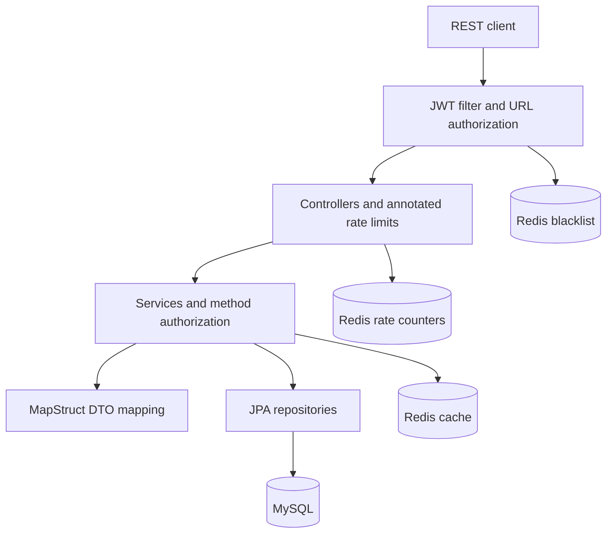
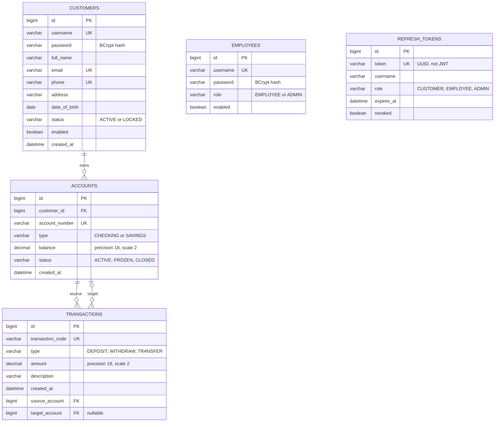

# SmartBank — Mini Banking System

SmartBank is a Java REST API that simulates a small banking system. It supports customer profiles, bank accounts, deposits, withdrawals, internal transfers, transaction statements, and role-based access for customers and staff.

The implementation uses database transactions, pessimistic account locks, JWT access tokens, database-backed refresh tokens, and Redis for caching, rate limiting, and access-token revocation. It is a learning project with [known limitations](#known-limitations); it has no frontend or external payment integration.

## Technology stack

| Component | Version / purpose |
| --- | --- |
| Java | 21 |
| Spring Boot | 3.4.4 |
| Spring Web, Security, Data JPA, Validation, Cache, Data Redis, AOP | Versions managed by Spring Boot |
| MySQL | 8.0 in Docker Compose |
| Redis | 7.2 Alpine in Docker Compose |
| JJWT | 0.12.6 |
| MapStruct | 1.6.3; generated Spring mapper beans |
| Lombok | 1.18.38; lombok-mapstruct-binding 0.2.0 |
| Maven | 3.9.14 via Maven Wrapper 3.3.4 |
| Tests | JUnit Jupiter, Mockito, AssertJ, Spring Test/Security Test; H2 for JPA slice tests |

Sources: [pom.xml](pom.xml), [Maven wrapper settings](.mvn/wrapper/maven-wrapper.properties), and [docker-compose.yml](docker-compose.yml).

## Architecture and data model

Controllers depend on service interfaces. Implementations contain business logic and use Spring Data repositories and MapStruct mappers. DTOs keep persistence entities and credentials out of normal API responses.



JWT authentication checks both Redis and the current database identity. HTTP sessions are disabled, but authentication is not independent of server-side storage.

```text
src/main/java/com/SmartBank/
├── SmartBankApplication.java
├── config/                 # SecurityConfig, RedisConfig
├── controller/v1/          # Auth, Customer, Account, Transaction
├── dto/request/            # Input and Jakarta Bean Validation
├── dto/response/           # ApiResponse, PageResponse, domain responses
├── entity/                 # Customer, Employee, Account, Transaction, RefreshToken
│   └── enums/              # Roles, types, statuses
├── exception/              # ErrorCode, AppException, ErrorResponse, advice
├── mapper/                 # MapStruct interfaces
├── repository/             # Queries, pagination, pessimistic locking
├── security/               # JWT, identity/state validation, ownership checks
│   ├── handler/            # Filter-chain 401/403 responses
│   └── ratelimit/           # @RateLimit and Redis Lua aspect
└── service/
    └── impl/               # Business logic, transactions, caching
src/test/java/com/SmartBank/ # Unit, MVC/security, and H2 JPA tests
```

### Entity relationships

The diagram shows core fields and actual account/transaction relationships. `RefreshToken.username` identifies a user by value; it is not a foreign key or JPA association to either user table.



Money uses `BigDecimal`. Account numbers are generated as 10-digit strings. A deposit/withdrawal records the affected account as `sourceAccount`, with `targetAccount=null`. A transfer writes one transaction record with both accounts. There is no transaction status field or idempotency entity.

Account and transaction relationships are LAZY. Statement indexes include `(source_account, created_at)` and `(target_account, created_at)`. See the [entity definitions](src/main/java/com/SmartBank/entity) for all constraints and indexes. Most timestamps use `LocalDateTime` and have no timezone offset.

## Local setup

### 1. Prerequisites

- JDK 21 for running/building locally.
- Docker and Docker Compose for the supplied MySQL/Redis setup or complete container deployment.
- Maven is optional: `mvnw` and `mvnw.cmd` are included. The first invocation may need network access to download Maven and dependencies.

Run commands from the repository root:

```bash
git clone https://github.com/NguyenNhatUS/SmartBank.git
cd SmartBank
```

### 2. Create the local configuration

Both `.env` and `src/main/resources/application.properties` are ignored by Git and are not tracked in the current repository. A fresh clone needs **both files** before running the application or building the Docker image. Keep any existing local configuration if it is already correct.

Create `src/main/resources/application.properties` with:

```properties
spring.config.import=optional:file:.env[.properties]
spring.datasource.url=${DB_URL}
spring.datasource.username=${DB_USERNAME}
spring.datasource.password=${DB_PASSWORD}
spring.jpa.hibernate.ddl-auto=${JPA_DDL_AUTO:update}
spring.jpa.show-sql=${JPA_SHOW_SQL:false}
spring.data.redis.host=${REDIS_HOST:localhost}
spring.data.redis.port=${REDIS_PORT:6379}
spring.data.redis.password=${REDIS_PASSWORD}
spring.data.redis.timeout=${REDIS_TIMEOUT:2000ms}
spring.cache.redis.time-to-live=${CACHE_TTL:10m}
jwt.secret=${JWT_SECRET}
jwt.expiration=${JWT_EXPIRATION:900000}
jwt.refresh-expiration=${JWT_REFRESH_EXPIRATION:604800000}
```

Create `.env` for the all-container setup. Replace every `REPLACE_WITH_...` value with your own secret. Use a random JWT signing secret with at least 32 bytes of key material. These are placeholders, not usable project credentials.

```properties
DB_URL=jdbc:mysql://mysql:3306/SmartBank?useSSL=false&serverTimezone=UTC&allowPublicKeyRetrieval=true&createDatabaseIfNotExist=true
DB_USERNAME=root
DB_PASSWORD=REPLACE_WITH_DATABASE_PASSWORD

REDIS_HOST=redis
REDIS_PORT=6379
REDIS_PASSWORD=REPLACE_WITH_REDIS_PASSWORD
REDIS_TIMEOUT=2000ms

JPA_DDL_AUTO=update
JPA_SHOW_SQL=false
CACHE_TTL=10m

JWT_SECRET=REPLACE_WITH_RANDOM_SIGNING_SECRET
# Access token: 15 minutes, in milliseconds
JWT_EXPIRATION=900000
# Refresh token: 7 days, in milliseconds
JWT_REFRESH_EXPIRATION=604800000
```

Keep comments on their own lines: Spring imports this file as Java properties. `CACHE_TTL` is mapped in properties, but the custom CacheManager hardcodes its TTLs; see [caching](#caching).

### 3. Start the services

**All services in Docker:** keep `DB_URL` pointing to `mysql:3306` and `REDIS_HOST=redis`.

```bash
docker compose up --build
```

**Local JVM with MySQL and Redis in Docker:** change these two `.env` values:

```properties
DB_URL=jdbc:mysql://localhost:3307/SmartBank?useSSL=false&serverTimezone=UTC&allowPublicKeyRetrieval=true&createDatabaseIfNotExist=true
REDIS_HOST=localhost
```

Then run:

```powershell
docker compose up -d mysql redis
.\mvnw.cmd spring-boot:run
```

On Linux/macOS, use `./mvnw spring-boot:run`. Restore the container hostnames when switching back to the all-container setup.

| Service | Host address | Compose address |
| --- | --- | --- |
| Application | `http://localhost:8080` | `app:8080` |
| MySQL | `localhost:3307` | `mysql:3306` |
| Redis | `localhost:6379` | `redis:6379` |

Compose persists data in `mysql_data` and `redis_data` volumes and waits for database/cache health checks before starting the app. MySQL initializes the configured root password when the database volume is first created; changing `.env` alone does not update an existing database password.

The [Dockerfile](Dockerfile) uses Temurin 21 JDK for the build and Temurin 21 JRE with a non-root `smartbank` user at runtime. Its Maven package step **skips tests**. Local packaging: `.\mvnw.cmd package`, then `java -jar target/SmartBank-0.0.1-SNAPSHOT.jar`.

There is no automatic ADMIN seed or default admin account. Registration creates only CUSTOMER identities. Administrative APIs require a separately provisioned Employee with role ADMIN, `enabled=true`, and a BCrypt password hash.

## API conventions

Base URL: `http://localhost:8080`. Send JSON bodies with `Content-Type: application/json`. Protected routes require:

```http
Authorization: Bearer <access_token>
```

Successful controller responses use [ApiResponse](src/main/java/com/SmartBank/dto/response/ApiResponse.java):

```json
{
  "code": 200,
  "message": "Success",
  "data": {},
  "timestamp": "2026-10-30T10:00:00"
}
```

`data` varies by endpoint and is omitted when null. Creation responses use HTTP 201 and `code=201`; other successes use HTTP 200 and `code=200`. IDs, timestamps, account numbers, and tokens below are illustrative.

Paginated responses place records in `data.content`, with `pageNo`, `pageSize`, `totalElements`, `totalPages`, and `last`. Non-paginated lists are arrays inside `data`, not top-level arrays.

### Endpoint reference

“Staff” means EMPLOYEE or ADMIN. “Owner” means an authenticated CUSTOMER whose username matches the account's customer. Roles do not inherit: `/accounts/my` remains CUSTOMER-only.

| Method | Route | Access | Success data / status |
| --- | --- | --- | --- |
| POST | `/auth/register` | Public | No data; 201 |
| POST | `/auth/login` | Public | LoginResponse; 200 |
| POST | `/auth/refresh` | Public, valid refresh token required | LoginResponse; 200 |
| POST | `/api/auth/logout` | Authenticated | No data; 200 |
| POST | `/admin/employees` | ADMIN | No data; 201 |
| POST | `/api/v1/customers` | ADMIN | CustomerResponse; 201 |
| GET | `/api/v1/customers` | ADMIN | PageResponse of CustomerResponse; 200 |
| GET | `/api/v1/customers/{id}` | ADMIN | CustomerResponse; 200 |
| PUT | `/api/v1/customers/{id}` | ADMIN | CustomerResponse; 200 |
| DELETE | `/api/v1/customers/{id}` | ADMIN | No data; 200 |
| GET | `/api/v1/customers/{id}/accounts` | ADMIN | AccountResponse array; 200 |
| POST | `/api/v1/accounts` | Staff | AccountResponse; 201 |
| GET | `/api/v1/accounts` | Staff | PageResponse of CustomerAccountResponse; 200 |
| GET | `/api/v1/accounts/{id}` | Staff or owner | AccountResponse; 200 |
| PATCH | `/api/v1/accounts/{id}/freeze` | Staff | AccountResponse; 200 |
| PATCH | `/api/v1/accounts/{id}/close` | Staff | AccountResponse; 200 |
| POST | `/api/v1/accounts/my` | CUSTOMER | AccountResponse; 201 |
| GET | `/api/v1/accounts/my` | CUSTOMER | AccountResponse array; 200 |
| POST | `/api/v1/transactions/deposit` | Staff or owner | TransactionResponse; 201 |
| POST | `/api/v1/transactions/withdraw` | Staff or owner | TransactionResponse; 201 |
| POST | `/api/v1/transactions/transfer` | Staff or source owner | TransactionResponse; 201 |
| GET | `/api/v1/transactions/account/{accountNumber}` | Staff or owner | PageResponse of TransactionResponse; 200 |

Sources: [AuthController](src/main/java/com/SmartBank/controller/v1/AuthController.java), [CustomerController](src/main/java/com/SmartBank/controller/v1/CustomerController.java), [AccountController](src/main/java/com/SmartBank/controller/v1/AccountController.java), [TransactionController](src/main/java/com/SmartBank/controller/v1/TransactionController.java), and [SecurityConfig](src/main/java/com/SmartBank/config/SecurityConfig.java).

### Authentication examples

Register with `POST /auth/register`:

```json
{
  "username": "demo_customer",
  "email": "demo@example.com",
  "password": "ExampleOnly-ChangeMe123!"
}
```

All three fields must be nonblank. Registration currently does not validate email format or password length. Success returns HTTP 201:

```json
{
  "code": 201,
  "message": "Register successful",
  "timestamp": "2026-10-30T10:00:00"
}
```

Login with `POST /auth/login`:

```json
{
  "username": "demo_customer",
  "password": "ExampleOnly-ChangeMe123!"
}
```

Success returns HTTP 200. Read tokens from **`data`**:

```json
{
  "code": 200,
  "message": "Login successful",
  "data": {
    "accessToken": "<access_token>",
    "refreshToken": "<refresh_token_uuid>",
    "username": "demo_customer",
    "role": "CUSTOMER"
  },
  "timestamp": "2026-10-30T10:01:00"
}
```

Refresh with `POST /auth/refresh` and `{"refreshToken":"<refresh_token_uuid>"}`. It returns the same data fields, new token values, and message `Token refreshed successfully`. An access token is not required. Save the new refresh token; the old one is marked revoked. Rotation is not atomic under concurrent requests.

Logout uses `POST /api/auth/logout` with the bearer header and **no body**. It returns HTTP 200 with `code=200`, message `Logout successful`, and a timestamp; `data` is omitted.

### Staff and customer profiles

An ADMIN can create an employee or another ADMIN with `POST /admin/employees`:

```json
{
  "username": "demo_staff",
  "password": "ExampleOnly-ChangeMe123!",
  "role": "EMPLOYEE"
}
```

Role CUSTOMER is rejected here. Success is HTTP 201 with `code=201`, message `Employee created successfully`, a timestamp, and no `data` field.

Create a customer profile with `POST /api/v1/customers`:

```json
{
  "fullName": "Nguyen Van A",
  "email": "customer.a@example.com",
  "phone": "0901234567",
  "address": "Ho Chi Minh City",
  "dateOfBirth": "2000-01-01",
  "username": "customer_a",
  "password": "ExampleOnly-ChangeMe123!"
}
```

Full name is required and limited to 100 characters; email must be valid; phone must be 10–11 characters; date of birth must be in the past. Username and password are required. Phone validation checks length, not digits.

Success is HTTP 201:

```json
{
  "code": 201,
  "message": "Customer created successfully",
  "data": {
    "id": 1,
    "fullName": "Nguyen Van A",
    "email": "customer.a@example.com",
    "phone": "0901234567",
    "address": "Ho Chi Minh City",
    "dateOfBirth": "2000-01-01",
    "status": "ACTIVE",
    "createdAt": "2026-10-30T10:02:00",
    "totalAccounts": 0
  },
  "timestamp": "2026-10-30T10:02:00"
}
```

`PUT /api/v1/customers/{id}` accepts the same request shape and returns HTTP 200 with message `Customer updated successfully`. The DTO still requires username/password, but the implementation updates only profile fields and ignores those credentials. It is not a password-change endpoint.

`DELETE /api/v1/customers/{id}` sets status to LOCKED; it does not delete the row or its accounts. The response is **HTTP 200**, not 204:

```json
{
  "code": 200,
  "message": "Customer deleted successfully",
  "timestamp": "2026-10-30T10:03:00"
}
```

### Account examples

A CUSTOMER opens an account with `POST /api/v1/accounts/my`:

```json
{
  "type": "CHECKING"
}
```

Supported types are CHECKING and SAVINGS. The owner comes from the authenticated username; this DTO has no `customerId`. Staff instead use `POST /api/v1/accounts` with `{"customerId":1,"type":"CHECKING"}`.

Successful self-service creation returns HTTP 201:

```json
{
  "code": 201,
  "message": "Customer account created successfully",
  "data": {
    "id": 12,
    "accountNumber": "1537284903",
    "type": "CHECKING",
    "balance": 0,
    "status": "ACTIVE",
    "createdAt": "2026-10-30T10:04:00",
    "customerId": 1,
    "customerName": "Nguyen Van A"
  },
  "timestamp": "2026-10-30T10:04:00"
}
```

The staff creation message is `Account created successfully`. A self-registered customer may have a null `customerName` until their profile is populated.

`GET /api/v1/accounts/my` and `GET /api/v1/customers/{id}/accounts` return an array of these account objects inside `data`, without pagination. `GET /api/v1/accounts/{id}` returns one object.

Freeze and close accept PATCH requests without a body. They return AccountResponse with status FROZEN or CLOSED and message `Account frozen successfully` or `Account closed successfully`. These operations currently do not check zero balance or validate state transitions; there is no unfreeze/reopen endpoint.

### Money operations

Deposit and withdraw accept [DepositWithDrawRequest](src/main/java/com/SmartBank/dto/request/DepositWithDrawRequest.java):

```json
{
  "accountNumber": "1537284903",
  "amount": 100000,
  "description": "Example deposit or withdrawal"
}
```

Use `POST /api/v1/transactions/deposit` or `/withdraw`. Amount must be between 1,000 and 500,000,000 inclusive; description is optional and limited to 255 characters. Withdrawal also requires sufficient balance.

Transfer uses `POST /api/v1/transactions/transfer` and [TransferRequest](src/main/java/com/SmartBank/dto/request/TransferRequest.java):

```json
{
  "sourceAccountNumber": "1537284903",
  "targetAccountNumber": "9876543210",
  "amount": 100000,
  "description": "Example internal transfer"
}
```

Transfer requires distinct accounts, sufficient source balance, and amount >= 1,000. The DTO has **no maximum transfer amount**. Description is optional and limited to 255 characters. CUSTOMER callers must own the source account; staff can operate on any account. All participating accounts must be ACTIVE.

A successful transfer returns HTTP 201:

```json
{
  "code": 201,
  "message": "Transfer successful",
  "data": {
    "id": 103,
    "transactionCode": "TXN1793330400000",
    "type": "TRANSFER",
    "amount": 100000,
    "description": "Example internal transfer",
    "createdAt": "2026-10-30T10:05:00",
    "sourceAccountNumber": "1537284903",
    "targetAccountNumber": "9876543210"
  },
  "timestamp": "2026-10-30T10:05:00"
}
```

Deposit/withdraw return the same envelope and fields, with messages `Deposit successful` / `Withdraw successful`, types DEPOSIT / WITHDRAW, and `targetAccountNumber=null`.

### Pagination

All three paginated routes default to `page=0&size=10`. Page indexes are zero-based.

| Route | Pagination behavior |
| --- | --- |
| `GET /api/v1/customers` | Customers ordered by `id DESC`; page >= 0 and size 1–100. Account counts are aggregated only for that page, without loading account collections. |
| `GET /api/v1/accounts` | Pages **customers**, then loads all accounts for those customers. Customers ordered by `id DESC`, accounts by `id ASC`. Same bounds as customer listing. |
| `GET /api/v1/transactions/account/{accountNumber}` | Transactions where the account is source OR target, ordered by `createdAt DESC`. Unlike the other lists, no explicit maximum size or custom range validation is implemented. |

Customer and account-group lists include LOCKED customers. Account groups include customers without accounts. Both lists read from the database without list caching. Invalid ranges or non-integer query parameters for these two lists return HTTP 400/code 1001. Pages beyond the end return empty content with actual totals.

Example account-group response:

```json
{
  "code": 200,
  "message": "Success",
  "data": {
    "content": [
      {
        "customerId": 1,
        "customerName": "Nguyen Van A",
        "customerEmail": "customer.a@example.com",
        "accounts": []
      }
    ],
    "pageNo": 0,
    "pageSize": 10,
    "totalElements": 1,
    "totalPages": 1,
    "last": true
  },
  "timestamp": "2026-10-30T10:06:00"
}
```

Here totals count customers, not accounts. Customer listing uses CustomerResponse records in `content`; statements use TransactionResponse records and message `Get account statement successfully`. An empty database gives `content=[]`, `totalElements=0`, `totalPages=0`, and `last=true` for the two customer-based lists.

## Authentication and concurrency details

### Identity and token lifecycle

- Login checks both Customer and Employee tables and rejects an ambiguous username instead of selecting one identity. Passwords are verified with BCrypt before inactive state is disclosed.
- JWT access tokens contain username (`sub`), role, issued/expiry times, and a UUID `jti`. Refresh tokens are UUID strings stored in the database, not JWTs.
- [UserAccessValidator](src/main/java/com/SmartBank/security/UserAccessValidator.java) checks current identity/state for access and refresh tokens. Disabled users or LOCKED customers receive 403/code 1104. Missing users, unsupported roles, changed staff roles, or ambiguous identities receive 401/code 1105.
- Locking blocks token use while inactive; it does not permanently revoke all tokens. Re-enabled users may reuse otherwise-valid tokens. Requests already past the state check are not retroactively cancelled.
- Logout stores only a SHA-256 hash of the presented access token under `token_blacklist:` in Redis, with its remaining lifetime as TTL, then deletes all refresh tokens for that username. Other access tokens for the same user remain valid until expiry if identity/state checks pass.
- Redis blacklist failures and database failures during UserAccessValidator checks fail closed with 503/code 1110. Other database/cache failures are not universally mapped to that status.
- `/auth/**` is public, but a supplied invalid bearer token is still rejected by the JWT filter. Login/refresh requests do not need a bearer header.

URL authorization and `@PreAuthorize` checks must both permit the request. Account detail and statement ownership checks are on controller methods; money-writing ownership checks are on service methods before balance changes. See [AccountSecurity](src/main/java/com/SmartBank/security/AccountSecurity.java) and [TransactionServiceImpl](src/main/java/com/SmartBank/service/impl/TransactionServiceImpl.java).

### Money transactions and locks

Deposits, withdrawals, and transfers use `@Transactional` and [pessimistic write locks](src/main/java/com/SmartBank/repository/AccountRepository.java). Balance changes and the transaction record are committed together or rolled back on failure.

Transfers acquire locks in lexicographic **account-number order**, then map the accounts back to source/target. Consistent ordering avoids opposite-order locking between transfers; it is not a guarantee against every database deadlock. Freeze/close use ordinary lookups rather than the same locking method.

### Rate limiting

[RateLimitAspect](src/main/java/com/SmartBank/security/ratelimit/RateLimitAspect.java) uses an atomic Redis Lua increment and sets expiry on the first request in the window. Keys are `rate_limit:<remoteAddr>:<requestURI>`; limits are per remote address and URI, not per user. The code uses `request.getRemoteAddr()` rather than forwarded-address headers.

| Endpoint | Limit |
| --- | --- |
| Register | 3 requests / 60 seconds |
| Login | 5 requests / 60 seconds |
| Deposit, withdraw, transfer | 10 requests / 60 seconds for each URI |
| Refresh, logout | No rate-limit annotation |

Exceeding a limit returns 429/code 1504. Redis failures in the aspect propagate to the generic error handler; they do not use the blacklist's dedicated 503 mapping.

### Caching

[RedisConfig](src/main/java/com/SmartBank/config/RedisConfig.java) defines JSON serialization, disables caching null values, and sets these TTLs in Java:

| Cache | Contents | TTL |
| --- | --- | --- |
| `accounts` | Detail by account id; personal account list by username | 5 minutes |
| `customers` | Customer detail by id | 30 minutes |
| `accounts_customers` | Account list by customer id | 10 minutes |
| Default | Other cache names | 10 minutes |

Changing `CACHE_TTL` alone does not override this custom CacheManager. Customer updates use CachePut; soft deletion evicts customer detail. Successful money operations evict all entries in the three caches. Account creation/freeze/close currently do not evict related caches, so subsequent reads can be stale until eviction or expiry.

## Error responses

[GlobalExceptionHandler](src/main/java/com/SmartBank/exception/GlobalExceptionHandler.java) maps business exceptions to [ErrorResponse](src/main/java/com/SmartBank/exception/ErrorResponse.java):

```json
{
  "code": 1402,
  "message": "Account is inactive",
  "path": "/api/v1/transactions/withdraw",
  "timestamp": "2026-10-30T10:07:00"
}
```

Selected codes returned by current flows (full enum: [ErrorCode](src/main/java/com/SmartBank/exception/ErrorCode.java)):

| Code | HTTP status | Meaning |
| --- | --- | --- |
| 1001 | 400 | Invalid pagination in customer/group lists, or wrong query/path parameter type |
| 1003 | 403 | Method authorization failure or forbidden employee role |
| 1100 / 1101 / 1102 | 400 | Duplicate username / email / phone where explicitly checked |
| 1103 | 401 | Invalid username/password or ambiguous login identity |
| 1104 | 403 | User inactive |
| 1105 | 401 | Invalid/expired/blacklisted access token, invalid identity, or unknown refresh token |
| 1108 / 1109 | 401 | Revoked / expired refresh token |
| 1110 | 503 | Authentication dependency unavailable in the checks described above |
| 1200 / 1400 | 404 | Customer / account not found |
| 1301 | 400 | Employee username already exists |
| 1402 | 400 | Account is not ACTIVE |
| 1501 | 400 | Insufficient balance in withdrawal/transfer |
| 1503 | 400 | Transfer to the same account |
| 1504 | 429 | Rate limit exceeded |

The enum contains additional values; their existence does not mean every related failure uses them. Bean Validation returns HTTP 400 with `code=400`; unhandled errors return HTTP 500 with `code=500` and message `System Error, try later`. A CUSTOMER's ownership denial can return 403 before a missing-account check is reached.

Filter-chain authentication/access-denied handlers use a **different schema** with `status` instead of `code`, for example a missing bearer token on a protected route:

```json
{
  "timestamp": "2026-10-30T10:07:00",
  "status": 401,
  "message": "Authentication required",
  "path": "/api/v1/accounts/my"
}
```

Filter-chain access denial uses status 403 and message `Access denied`. Method authorization denial handled by MVC advice uses code 1003. Clients should account for both formats.

## Testing and a local API walkthrough

### Automated tests

```powershell
# Full suite: prepare the runtime configuration and database first
.\mvnw.cmd test

# Unit and slice tests, excluding the full application context test
.\mvnw.cmd "-Dtest=!SmartBankApplicationTests" test

# Focused security checks
.\mvnw.cmd "-Dtest=EndpointAuthorizationTest,AccountSecurityTest,TokenBlacklistTest,AuthServiceTest,JwtTokenProviderTest,AuthLoginResponseTest" test

# Pagination HTTP and JPA checks
.\mvnw.cmd "-Dtest=CustomerPaginationTest,CustomerPaginationJpaTest,AccountGroupPaginationTest,AccountGroupPaginationJpaTest" test
```

On Linux/macOS replace `.\mvnw.cmd` with `./mvnw`; use single quotes around the `-Dtest` argument to avoid interactive Bash history expansion around `!`.

- Service unit tests mock repositories; they do not prove real MySQL locking or rollback.
- Standalone MockMvc tests verify response/pagination contracts without the security filter chain or rate-limit aspect.
- `EndpointAuthorizationTest` runs real JWT/filter/method authorization and auth/transaction service logic with mocked persistence and blacklist dependencies.
- `CustomerPaginationJpaTest` and `AccountGroupPaginationJpaTest` use H2, real repositories/mappers, and in-memory cache configuration. They check ordering, totals, and query counts without paginating fetched collections.
- `TokenBlacklistTest` verifies hash keys, requested TTL, logout behavior, and failure handling with mocked Redis; it does not test Redis expiration itself.
- `SmartBankApplicationTests.contextLoads` starts the complete application context with runtime configuration; it has no isolated test profile.

Reports are written to `target/surefire-reports/`. These commands describe how to verify the project; this documentation update does not claim a new successful test run.

### PowerShell walkthrough

With the app and dependencies running, this registers a customer, logs in, opens an account, deposits money, and reads the statement. Use a new username/email on repeated runs. Credentials below are demonstration values.

```powershell
$baseUrl = 'http://localhost:8080'
$registration = @{
    username = 'demo_customer'
    email = 'demo@example.com'
    password = 'ExampleOnly-ChangeMe123!'
} | ConvertTo-Json
Invoke-RestMethod -Method Post -Uri "$baseUrl/auth/register" -ContentType 'application/json' -Body $registration

$credentials = @{
    username = 'demo_customer'
    password = 'ExampleOnly-ChangeMe123!'
} | ConvertTo-Json
$login = Invoke-RestMethod -Method Post -Uri "$baseUrl/auth/login" -ContentType 'application/json' -Body $credentials
$headers = @{ Authorization = "Bearer $($login.data.accessToken)" }

$account = Invoke-RestMethod -Method Post -Uri "$baseUrl/api/v1/accounts/my" -Headers $headers -ContentType 'application/json' -Body '{"type":"CHECKING"}'
$deposit = @{
    accountNumber = $account.data.accountNumber
    amount = 100000
    description = 'Demo deposit'
} | ConvertTo-Json
Invoke-RestMethod -Method Post -Uri "$baseUrl/api/v1/transactions/deposit" -Headers $headers -ContentType 'application/json' -Body $deposit
Invoke-RestMethod -Method Get -Uri "$baseUrl/api/v1/transactions/account/$($account.data.accountNumber)?page=0&size=10" -Headers $headers
```

## Known limitations

These are implementation limits, not implemented features or claims of production readiness:

- No idempotency key support: retrying a money request can perform another transaction.
- Transaction codes use `TXN` plus current milliseconds and can collide. Random account-number generation checks existence before insertion but has no collision retry for concurrent inserts.
- Refresh rotation has no transaction/row lock covering the full flow, so concurrent refreshes are not guaranteed to consume a token once. There is no token-family revocation or scheduled token cleanup.
- Username checks across Customer and Employee are application-level checks, not a shared database uniqueness constraint. Ambiguous identities are denied if a race creates duplicates.
- Logout spans Redis and MySQL without a distributed transaction; partial completion is possible.
- Cache invalidation is incomplete for account creation/status changes and profile fields copied into account responses.
- Freeze/close have no zero-balance or transition checks and do not share the money-operation locking path.
- Amount DTOs do not enforce fractional digit limits; transfers have no explicit maximum amount or separate balance-overflow guard.
- Statements have no explicit maximum page size. Personal account lists are unpaginated, and account-group pagination returns every account for each selected customer.
- Registration does not precheck email uniqueness; profile update does not precheck email/phone uniqueness. Database constraint failures can become generic 500 responses. Update DTOs require credentials that the service ignores.
- Schema management defaults to Hibernate `ddl-auto=update`; there are no versioned migrations, automatic admin bootstrap, or CI pipeline in this repository.
- The suite does not establish behavior under concurrent real MySQL transfers, real Redis rate limiting/TTL, or a complete deployed end-to-end flow.
